# Umoja Hardware System — User Training Guide

**For trainers and new users** · Production: <https://umoja.ehub.co.tz> · Mobile: *Umoja Pro* (Android) · *Edition of 13 September 2026 — covers the cash desk, Sales Accounting, vouchers & the General Ledger, the three statements, bulk import and the CRM register.*

This guide is written to be delivered as a training session. Work through it in order:

1. **Part A — Getting started** (everyone): sign in, find your way around, the golden rule of roles.
2. **Part B — Your role**: each role has its own chapter — including the **Cashier** and a much longer **Accountant** chapter (the books). Find yours and read it end to end.
3. **Part C — The big flows**: how a purchase, a sale, money going out, the till reaching the books, and back-dated work move through *several* roles. This is the part most people get wrong, so spend time here.
4. **Part D — Mobile app, troubleshooting, and a hands-on checklist** you can run live with trainees.

> **How to use this in a classroom:** project this file, sign in as each role using the test logins your administrator provides, and have each trainee do the "Try it now" exercise at the end of their chapter on the live system.

---

## Part A — Getting started (everyone)

### A1. Sign in
1. Open **https://umoja.ehub.co.tz** in a web browser (Chrome or Edge recommended).
2. Type your **username** and **password**.
3. Click **Sign in**.

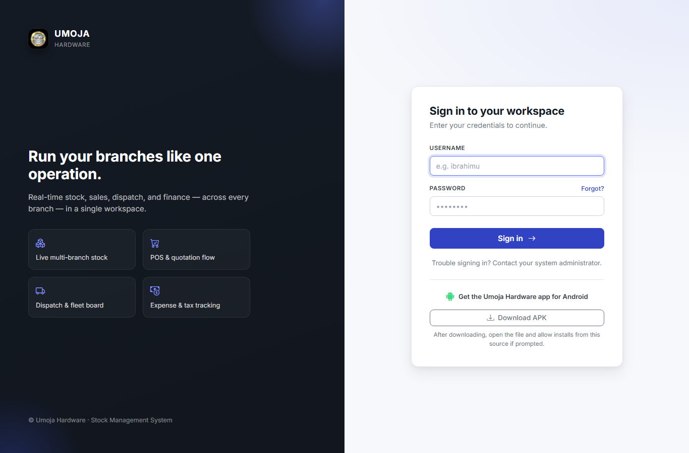

> Your administrator creates your account and gives you the first password. Change it from **Profile** after your first login.

### A2. The dashboard and the sidebar
After signing in you land on the **Dashboard**. The cards at the top tell you what needs attention *right now* (today's revenue, low-stock items, orders waiting, pending approvals). The **left sidebar** is your menu.

Your own work comes first. Under **Overview** the sidebar opens with **My Workspace** — the menu for
your role — and only then the shared sections (Catalog, Commerce, CRM, Finance, HR, Administration).
So an Afisa Ugavi finds *Purchase Orders* at the top of the menu, not buried below stock and sales.
Opening one menu closes the others.

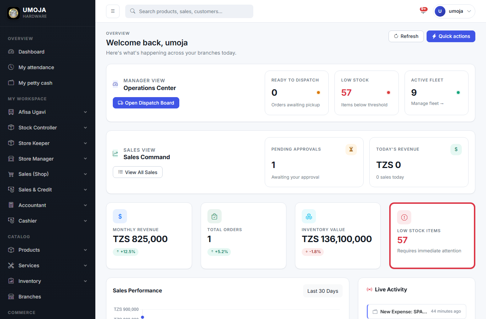

### A3. The golden rule: you only see what your role allows
**The menu changes depending on who you are.** A Sales Rep does not see Finance. An Accountant does not see Dispatch. If a colleague has a button you don't, that's by design — your role doesn't include that permission.

> **If a menu item or button is missing**, it is almost always a permissions matter, not a bug. Ask your System Administrator to check your role.

### A4. Sessions time out
For security, you are signed out after **20 minutes of inactivity**, and always when you close the browser. Just sign in again. Cookies are locked down (HttpOnly/Secure) — this is normal.

### A5. My attendance (everyone with a linked staff record)
Every signed-in user has a **My attendance** link at the top of the sidebar to clock in/out for the day. This only works if your login has been linked to your employee record (your administrator does this). See the HR chapters for the full attendance flow.

### A6. Every table can be exported, and long tables page themselves
Any list with an **Export CSV / Print** bar above it (the cash desk, the vouchers register, the General Ledger,
supplier accounts…) exports **exactly what the filters show** — including rows the pager has scrolled past — as
a CSV that opens cleanly in Excel. Long tables show 10 rows at a time with **10 / 25 / 50 / 100** controls
underneath; a table with ten rows or fewer is left as it is.

### A7. Notifications
The **bell** at the top right is your inbox. The system writes a notification when something needs *you*: a
short delivery to explain, a supplier payment approved or rejected, a petty cash request decided, a posted sale
queried by Accounts. Click one to jump to the screen it is about.

### A8. My petty cash (everyone)
Anyone can ask for petty cash — for a bus fare, a spare part, a courier. **My petty cash** (top of the sidebar)
shows your own requests and lets you raise a new one: the amount, what it is for, and the branch. It goes
**Pending → Approved (by an Admin) → Issued (by the Cashier, when the money is in your hand)**, or **Rejected**
with a reason. You only ever see your own requests; the Admin and the Cashier see everyone's because they act on
them. The float only moves when the Cashier presses **Done** — a promise is not cash.

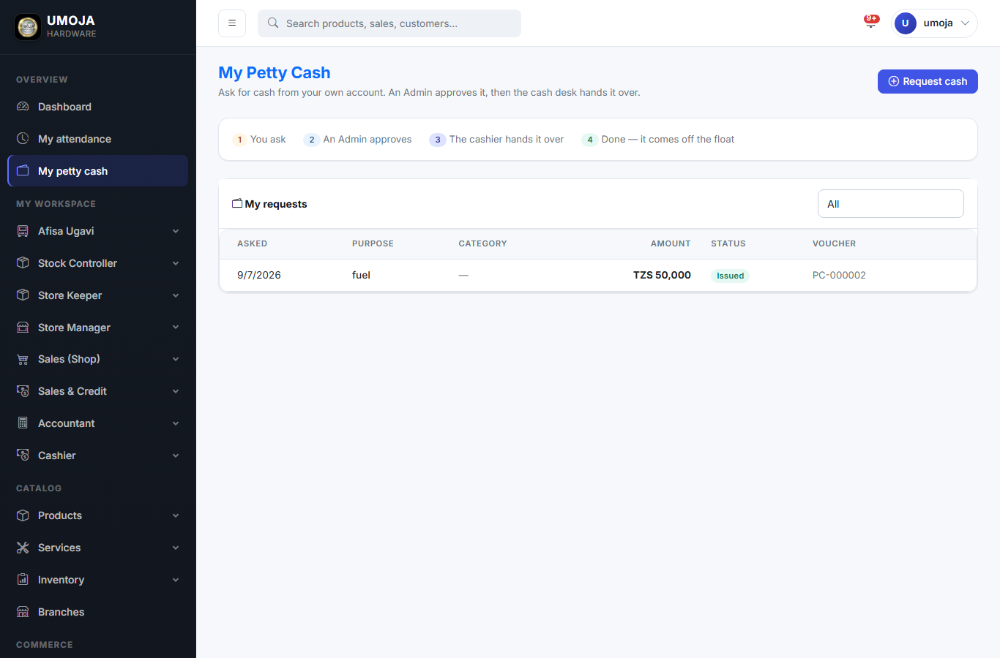

---

## Part B — Roles at a glance

| Role | Who they are | Main job in the system |
|---|---|---|
| **System Administrator** | Owner / IT lead | Set up the business; manage users & roles; **decide every approval queue** (deliveries, supplier payments, petty cash); can do everything |
| **Manager** | General manager | Oversight of products, sales, and reports |
| **Procurement Officer** (*Afisa Ugavi*) | Buyer | Manage suppliers, raise Purchase Orders, inbound trucks |
| **Stock Controller** | Receiving clerk | Receive goods (GRN) against POs, keep stock balances accurate |
| **Store Keeper** | Warehouse staff | Pick goods for dispatch, load the truck |
| **Sales Representative** | Cashier / salesperson | Take orders at POS, manage customers & quotations |
| **Store Manager** | Floor supervisor | Verify deliveries item by item, run dispatch, move stock between branches |
| **Sales & Credit Manager** | Sales supervisor | Approve/decline orders, chase credit customers, record payments received |
| **Cashier** | Holder of the cash tin | Petty cash float, hand out approved petty cash, **record** supplier payments and other payouts (the Admin approves them) |
| **Accountant** | Bookkeeper | Take sales into the books, post vouchers, run the General Ledger and the three statements, keep the CRM register, expenses, income, taxes |
| **HR Officer** | HR administrator | Maintain employee records, leave, attendance, documents |
| **HR Manager** | Head of HR | Everything HR Officer does, **plus** payroll, departments, performance & discipline |
| **Staff** | General employee | Self-service only (clock in/out, profile, petty cash requests) |

> **Two separate fleets — don't mix them up:** *Trucks/Drivers* (Inventory) are for goods coming **in** from suppliers. *Vehicles* (Sales) are for goods going **out** to customers. They are intentionally different lists.

> **Three things wait for an Admin.** Short deliveries, supplier payments and petty cash requests are all
> *requests* until an Administrator says yes. Nobody else can approve their own work, and the queues are on the
> Admin's sidebar under **Administration**.

---

## Part B — Role chapters

Each chapter follows the same shape: **Who you are → What you can do → Your daily flow → Tips → Try it now.**

---

### 1. System Administrator

**Who you are:** the owner or IT lead who sets the system up and keeps it healthy.

**What you can do:** everything. You configure the business once (branches, categories, users, roles), then mostly watch the dashboard for problems.

**Your daily flow**

1. **Sign in** and review the **Admin dashboard** — orders to dispatch, low stock, pending approvals, today's revenue.
   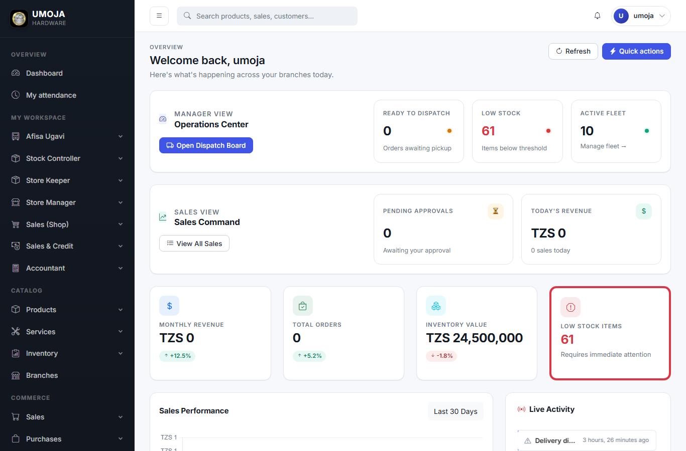
2. **Create branches** — *Inventory → Branches → Add branch*. Every stock level and every sale is tied to a branch, so set these up **first**.
   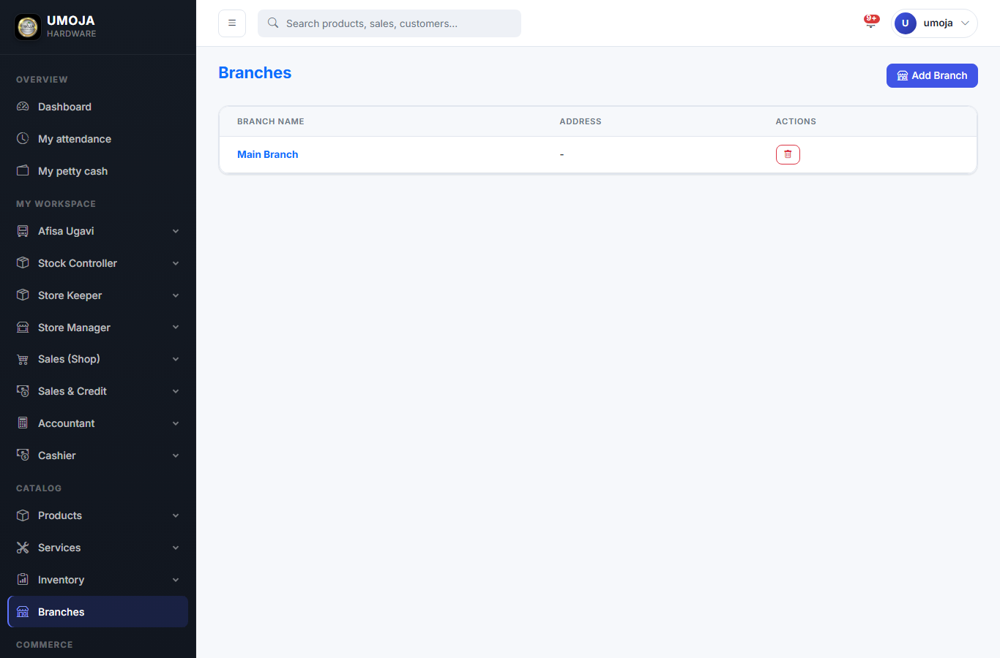
3. **Create categories** — *Inventory → Categories*. Each category carries a **commission %** applied to every sale of its products. (Old sales keep their old rate even if you change it later.)
   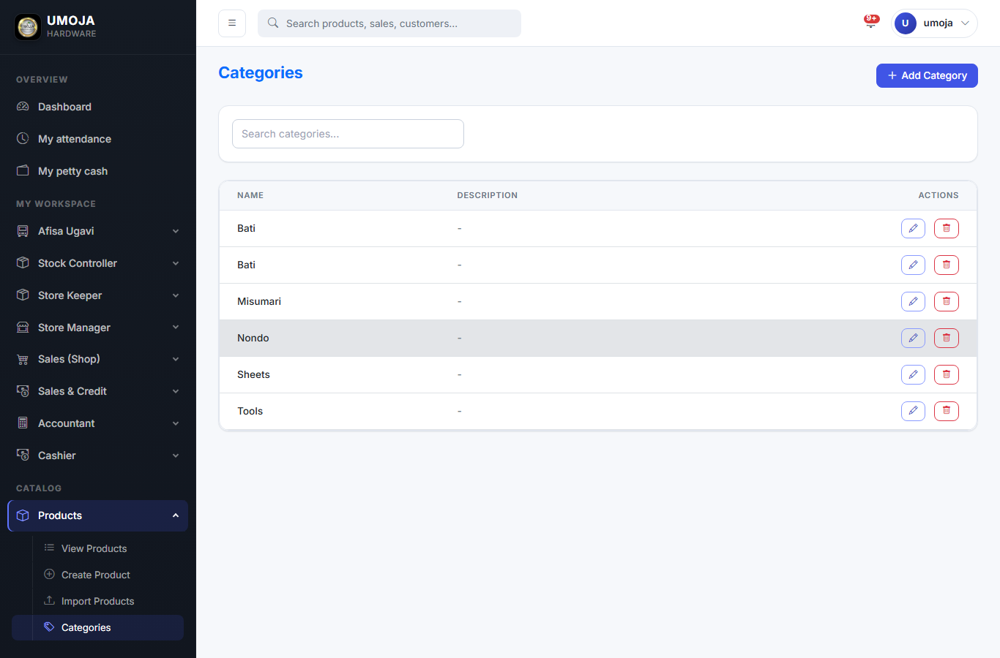
4. **Manage users** — *Users*. Each user gets a **role** that decides their menu and permissions.
   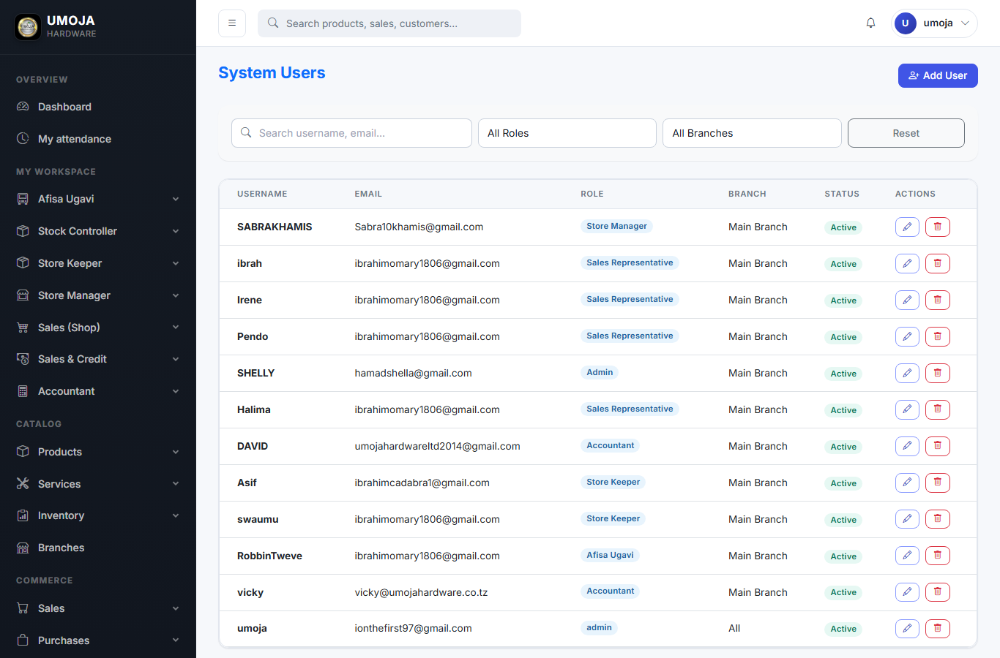
5. **Manage roles** — *Roles*. Review which permissions each role grants.
   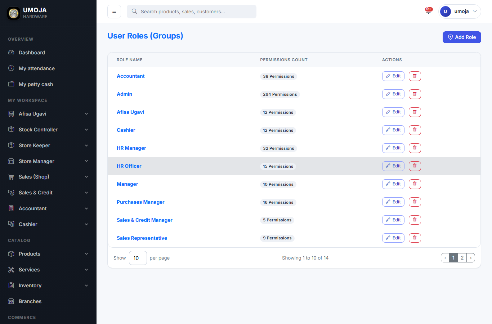
6. **Delivery Approvals** — *Administration → Delivery Approvals*. Short deliveries the Store Manager
   flagged and Afisa Ugavi has explained wait here for you. **Confirm** takes the goods that did arrive
   into stock and leaves the balance owing; **Reject** sends it back for a better explanation and banks
   nothing. Until you decide, none of that delivery is stock. Clear this screen daily — goods sitting
   here are goods the shop cannot sell.
   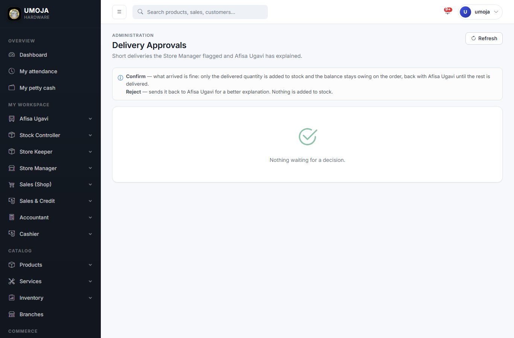
7. **Supplier Payment Approvals** — *Administration → Supplier Payment Approvals*. Every payment the Cashier
   records is a **request**. **Approve** makes it paid — only then does the order's balance fall and the money
   show in the Cash Flow. **Reject** with a decision note sends it back to the Cashier, who amends it and
   resubmits; your note and their reply stay on the record.
   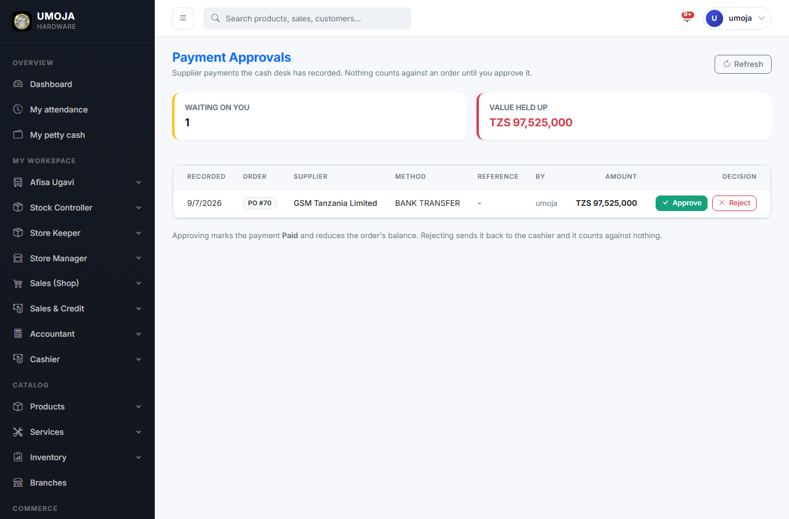
8. **Petty Cash Approvals** — *Administration → Petty Cash Approvals*. Requests anyone in the business has
   raised for petty cash. **Approve** or **Reject** (with a reason). Approving does not move cash — the Cashier
   hands it over and presses Done, and *that* is when the float falls.
   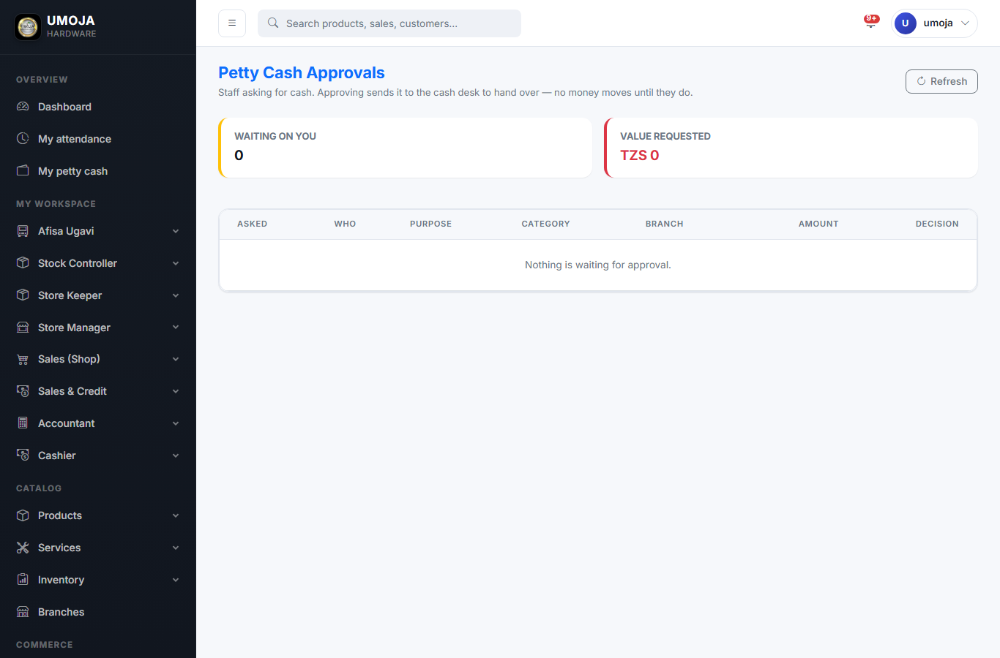
9. **Bank accounts** — *Finance → Banks*. The accounts payments are made from. Each gets a ledger in the books
   automatically.
10. **Company settings** — *Settings*. Company name, logo, TIN/VRN, currency (TZS), default **tax rate** (the VAT
    box on Sales/Purchase vouchers uses it) — these appear on receipts and invoices.
   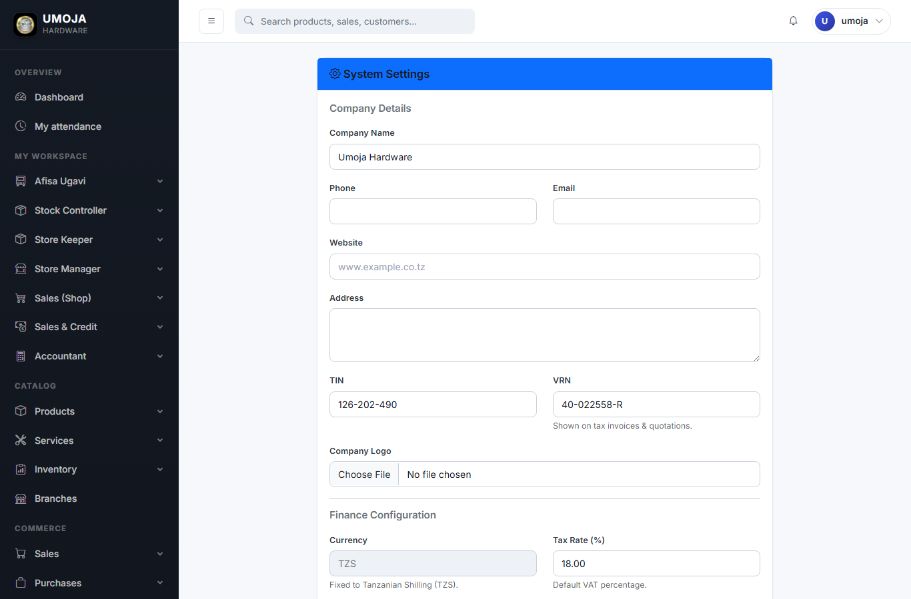

**Tips**
- After installing the system, the administrator runs `python manage.py create_roles` once to seed all role groups and permissions. Re-run it whenever roles or permissions change.
- The **Reports** menu shows inventory aging, profitability by category, and commission per sales rep.
- Secrets (keys, DB password) live only in the server's `.env` file — never share them.

**Try it now:** create a test branch, a test category with 5% commission, and a test Sales Rep user. Then open
each of the three approval queues and read what is waiting.

---

### 2. Manager

**Who you are:** a general manager who needs oversight without doing the day-to-day data entry.

**What you can do:** view and edit products; view, change and cancel sales; view sales and inventory reports; view/add/edit users.

**Your daily flow**
1. Review the **dashboard** for the day's numbers and anything flagged.
2. **Products** — check the catalog, prices, and stock health (*Catalog → Products*, *Inventory*).
3. **Sales** — review the sales list, follow up on anything stuck (*Commerce → Sales*).
4. **Reports** — read profitability, aging, and commission reports (*Reports*).

**Tips**
- Managers see the **Dispatch Board** and **Vehicles** too — handy for covering for a Store Manager.
- Use reports for decisions; leave the data entry to the specialist roles.

---

### 3. Procurement Officer (*Afisa Ugavi*)

**Who you are:** the person who orders goods from suppliers.

**What you can do:** manage suppliers; raise and edit Purchase Orders (POs); manage inbound trucks and truck allocations.

**Your daily flow**

1. Open your **dashboard** (scoped to procurement tasks).
   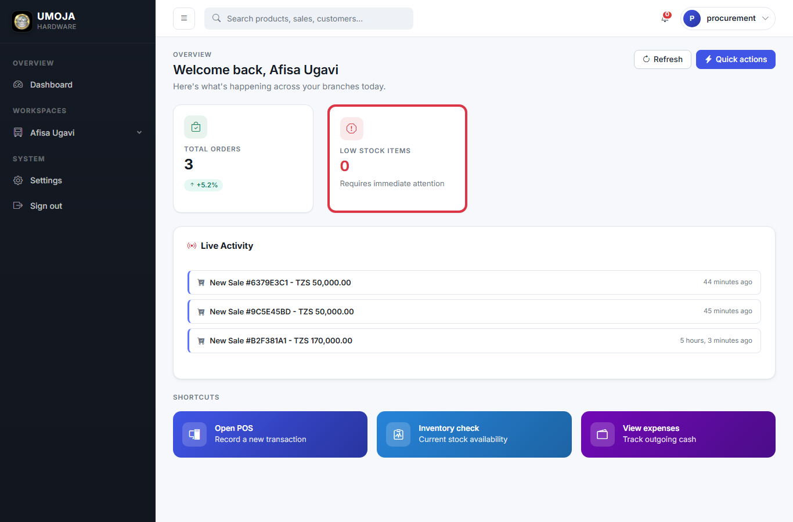
2. **Manage suppliers** — *Inventory → Suppliers*. Add suppliers with contact info; each PO is tied to one supplier.
   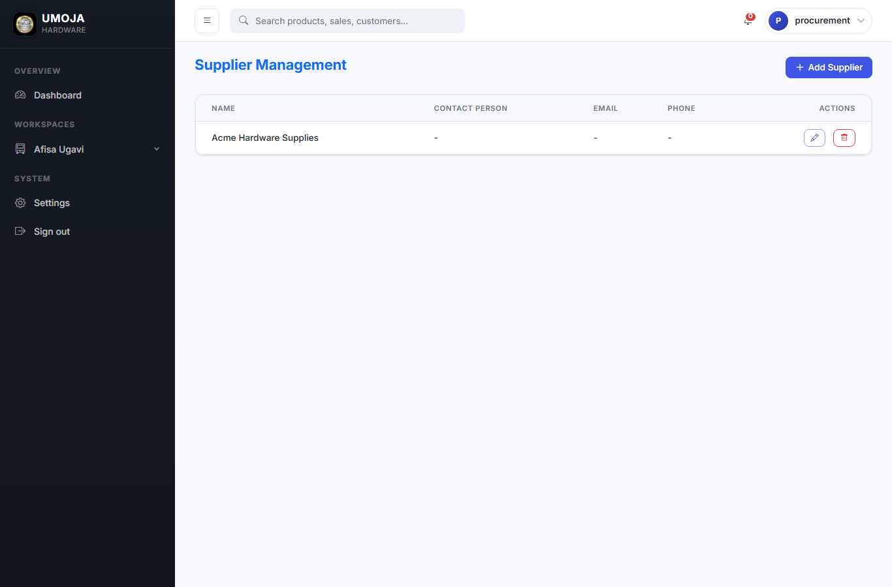
3. **Purchase Orders** — *Inventory → Purchase orders*. The list shows open, received, and closed POs.
   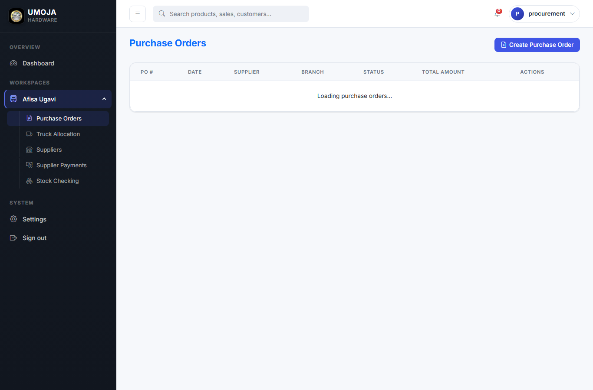
4. **Raise a new PO** — pick the supplier, add line items (product + quantity + agreed price). The PO is tracked until goods arrive.
   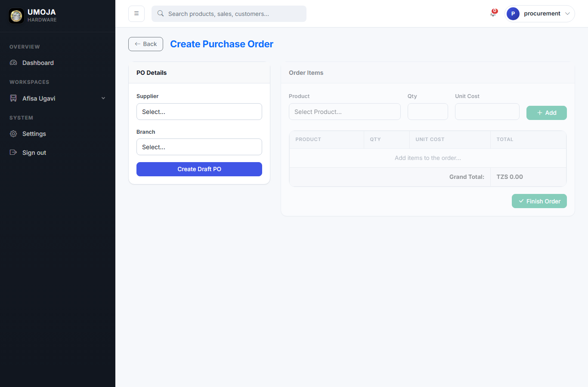
5. **Confirm the goods arrived** — when the supplier delivers, open the PO and click **Confirm**.
   The order goes to the Store Manager, who counts it. *You are saying "it has turned up", not "it is all here".*
6. **Explain a shortfall** — if the Store Manager finds items missing, the order comes back to you marked
   **Discrepancy** with a **Add Comment** button. Write what happened (supplier short-shipped, damaged in
   transit, back-ordered). Your comment goes to the **Admin**, who confirms or rejects it.
   If the Admin rejects it, the order returns marked **Re-comment** with the Admin's reason — answer it properly.
7. **Confirm the balance** — an order the Admin part-confirmed sits as **Partially Received**, listing exactly
   what is still owed. When the rest is delivered, click **Confirm Balance** and it goes round again — the
   Store Manager then checks only the outstanding quantity.
8. **Supplier credit** — if the Cashier has ever over-paid a supplier, the order form shows the **credit** that
   supplier holds for us, and the Cashiers are told when you raise an order for them, so the credit gets used.
9. **Inbound fleet** — *Inventory → Trucks* (deliveries **from** suppliers), *Drivers*, *Maintenance*, and
   *Transport* for the cost of each trip.
   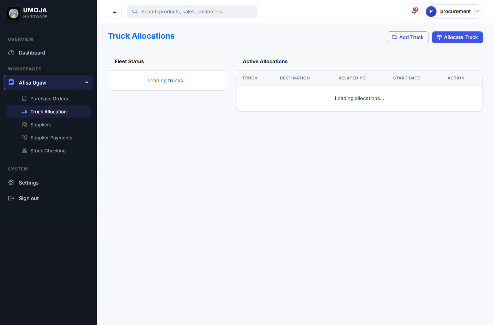

**Tips**
- **Trucks here = inbound** from suppliers. **Vehicles (Sales) = outbound** to customers. Don't mix them.
- Raise the PO **before** the supplier ships — the delivery check matches against it line by line.
- **Confirming is not receiving.** Nothing becomes stock because you clicked Confirm; the store still has to count it.
- Chase the **Partially Received** list — those are goods you have paid for or ordered and not yet got.

**Try it now:** add a supplier, raise a PO for two products, and confirm it through to the Store Manager.

---

### 4. Stock Controller

**Who you are:** the receiving clerk who books incoming goods into the system.

**What you can do:** create Goods Received Notes (GRNs); view and adjust stock; view products. **Receiving a GRN is the only thing that increases stock.**

**Your daily flow**

1. Open your **dashboard** (receiving + stock health).
   
2. **GRN list** — *Inventory → GRNs*. One GRN per delivery received.
   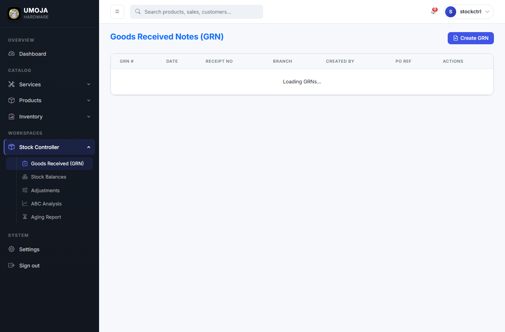
3. **Receive goods (new GRN)** — *Inventory → GRNs → Create*. Pick the matching **PO**, then enter the quantities **actually received** per product. Stock is added to your branch the moment you save.
   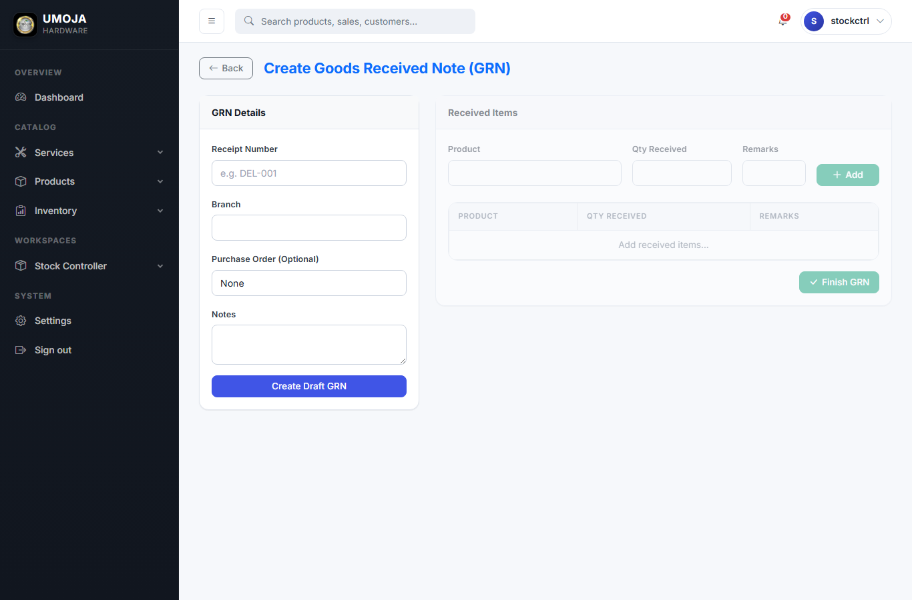
4. **Live stock** — *Inventory → Inventory*. Current quantity per product per branch. A red badge = at or below the low-stock threshold.
   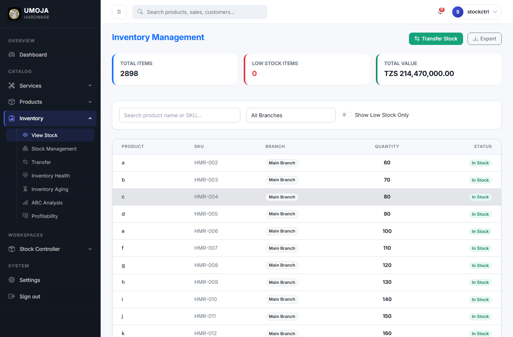

**Tips**
- If you received **less** than the PO quantity, that's fine — the PO stays open for the remainder.
- Set sensible **low-stock thresholds** on each stock row so dashboard alerts fire *before* you run out.

**Try it now:** receive a GRN against the PO the Procurement Officer raised, and confirm stock went up.

---

### 5. Store Keeper

**Who you are:** warehouse staff who pick goods for dispatch.

**What you can do:** view stock and the sales you've been assigned; help verify GRNs; load goods at dispatch.

**Your daily flow**

1. Open your **dashboard** (minimal — just what you need to pick orders).
   
2. **See assignments** — *Sales → Dispatch*. Filter to orders assigned to you; each row shows the customer, products to pick, and the delivery vehicle.
   
3. **Cross-check the sale** — *Sales → Sales*. Confirm customer, products and quantities before picking.
   

**Tips**
- If an item is short, tell the **Store Manager before dispatch** — once dispatched, stock is deducted.
- You can print a delivery note from the sale's actions menu (it has the customer's address).

---

### 6. Sales Representative

**Who you are:** the cashier or salesperson at the counter or on the phone.

**What you can do:** take orders at the POS; record payment (cash, mobile money, bank transfer, or credit); manage customers; create quotations. You **submit** orders — your manager approves and dispatches them.

**Your daily flow**

1. Open your **dashboard** (Commerce-focused).
   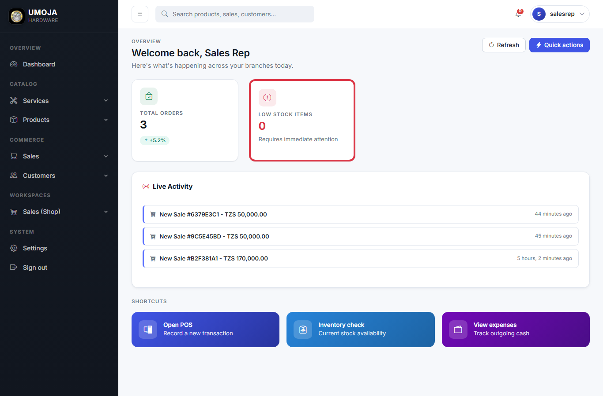
2. **Open the POS** — *Sales → POS*. Search products, add to cart, pick a customer, record payment, submit. The sale becomes **Pending approval**.
   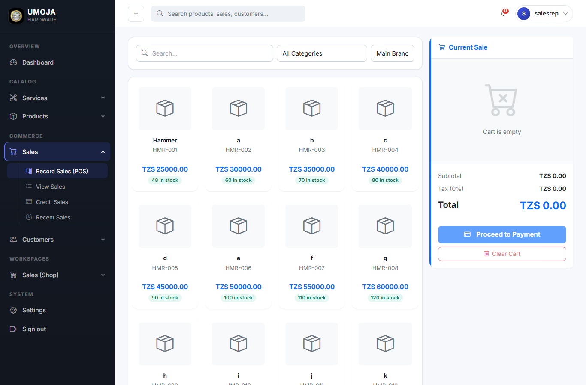
   - **No back-orders.** The POS refuses any sale the branch cannot fill. "Available" is the stock on the shelf
     **minus what is already promised** on other pending and approved sales — so three reps cannot each sell the
     same last five bags. **Services** are never stock-limited.
   - **Credit sale with a deposit** — choose *Credit*, type the deposit taken now; the rest stays as the balance
     owed and the customer appears in Debtors until it is paid.
3. **Sales list** — *Sales → Sales*. Your past sales with status (Pending, Approved, Dispatched, Cancelled) and amount paid vs balance.
   
4. **Customers** — add new customers; each customer's history is one click away.
   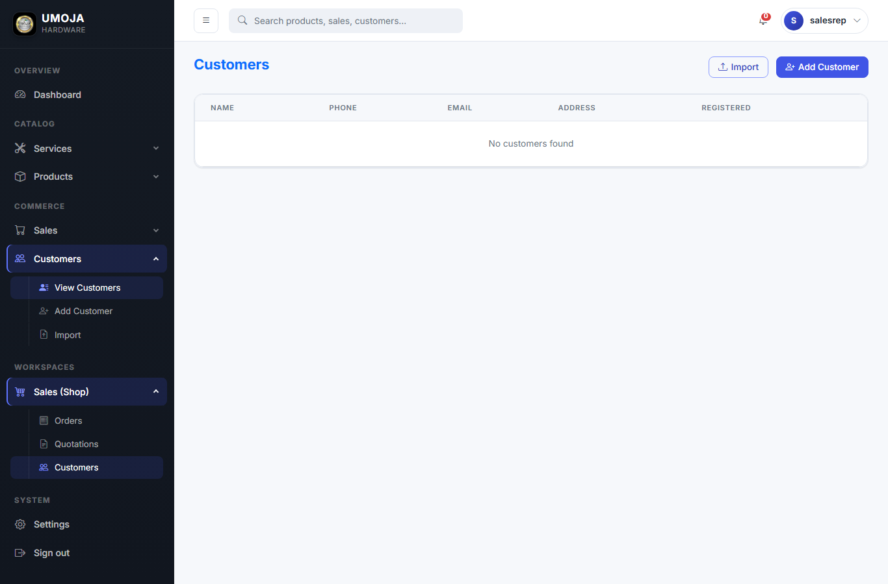
5. **Quotations** — written price estimates that **do not touch stock**. Convert to a sale in one click when the customer commits.
   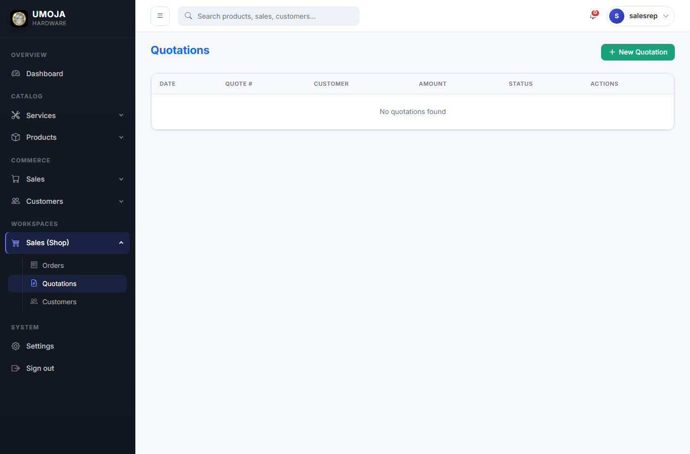

**Tips**
- **Commission is calculated automatically** from the product's category and **frozen** on the sale — later rate changes don't affect it.
- If a product won't appear in search, it may be **out of stock at your branch**. If the POS refuses the
  quantity, the stock is there but already promised to another sale — check *Order management*.
- Use **Quotations** for big-ticket items the customer wants to think about.

**Try it now:** create a quotation, then convert it into a sale and submit it.

---

### 7. Store Manager

**Who you are:** the floor supervisor who approves orders and runs dispatch.

**What you can do:** approve/decline pending orders; dispatch approved orders (assign a picker + vehicle); manage drivers, truck maintenance, and stock transfers between branches.

**Your daily flow**

1. Open your **dashboard** — ready-to-dispatch count, low-stock count, active fleet.
   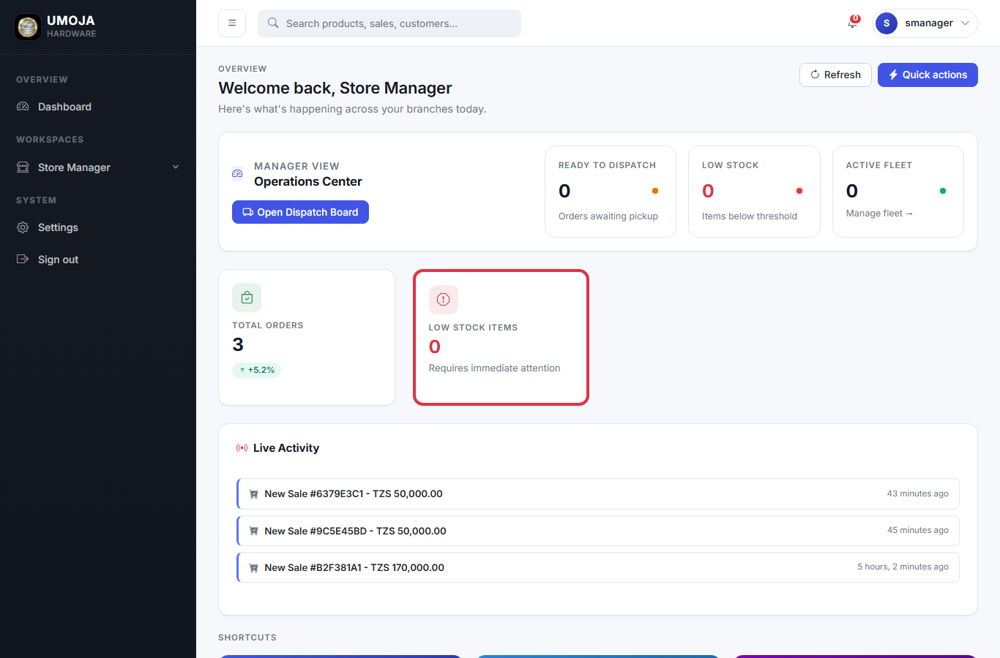
2. **Deliveries to Verify** — *My Workspace → Deliveries to Verify*. Every order Afisa Ugavi has confirmed
   is listed here. **Open one order at a time** — you cannot check them all on one screen, by design.
   Inside, work down the items **one by one**: click **All N arrived**, or **Short** and type how many
   actually came plus a note saying what is missing. The counter shows "2 of 3 items checked" and the
   **Submit** button stays locked until every item has been counted.
   - Everything arrived → stock goes up immediately and the order closes.
   - Anything short → the order goes to Afisa Ugavi to explain, then to the Admin. **Nothing enters stock**
     in the meantime, so do not tell the shop the goods are available yet.
   A balance delivery comes back to this screen showing only the items still owed.
3. **Order Management — approve or decline** — *Sales → Order management*. Approve only after checking the customer is real and the price is right.
   
4. **Dispatch Board — assign & ship** — *Sales → Dispatch board*. Pick an approved order → choose a **Store Keeper** to pick → choose a **Vehicle** (or type hired-lorry info) → click **Dispatch**.
   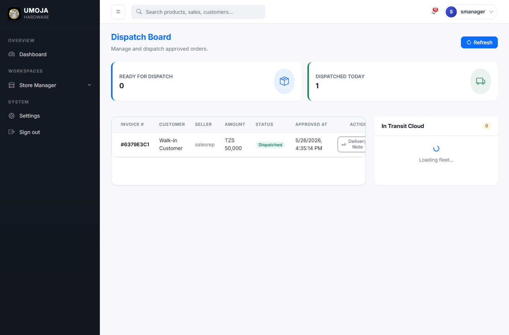
5. **Track vehicles** — *Sales → Vehicles*. See Active vs In-transit; mark a returned vehicle **Active** so it can be reused.
   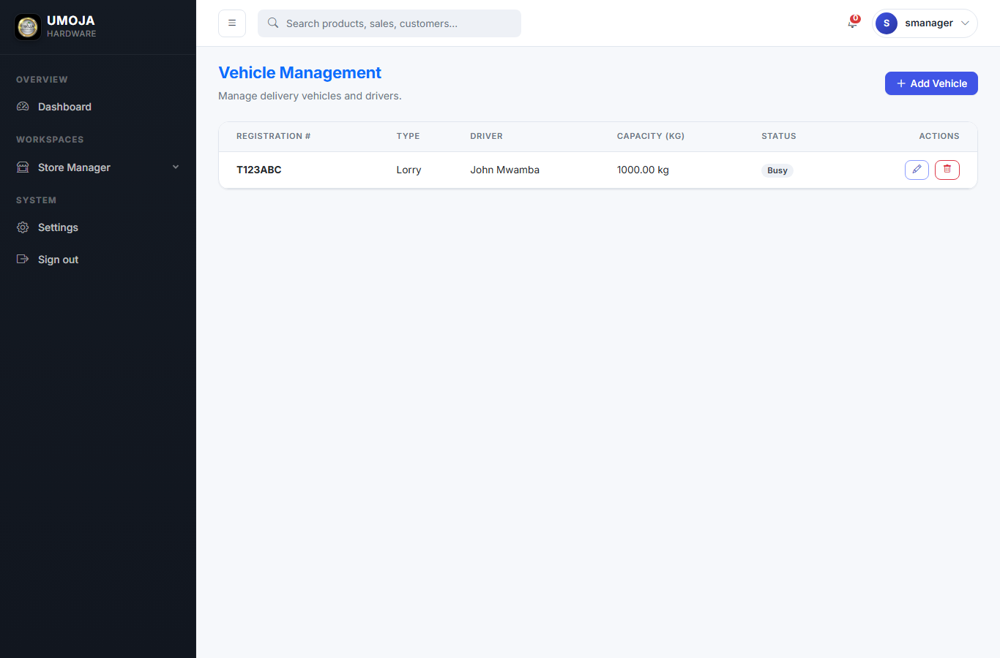
6. **Move stock between branches** — *Inventory → Transfer*. Stock leaves the source branch and enters the destination.
   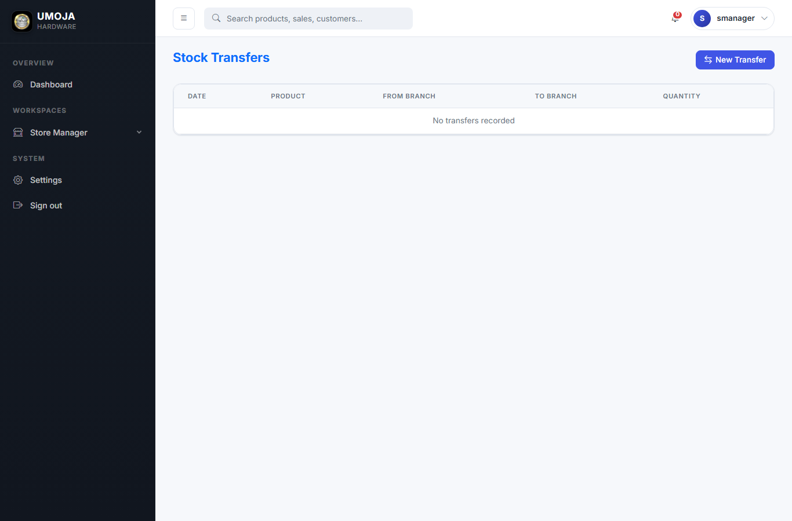
7. **Stock In vs Out** — *Inventory → Reports → Stock movements*. For each item, what came in (deliveries, GRNs,
   transfers in, adjustments) against what went out (dispatches, transfers out) over a period. **Export** the
   whole report to Excel, or one item alone from its card — the file is named after the item.
   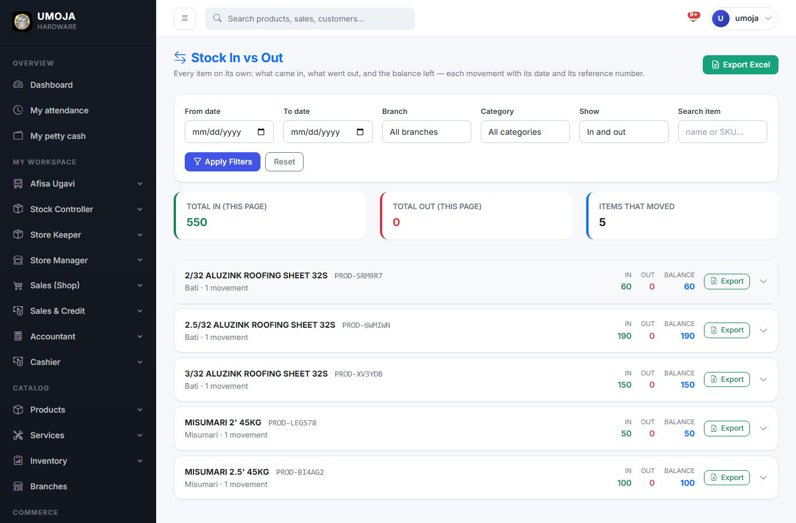
8. **Stock adjustments** — *Inventory → Stock adjustment*, for counts, damage and write-offs, each with a reason
   and recorded against the person who made it.

**Tips**
- **Stock only moves at Dispatch**, *not* at Approve. Approve just clears the order for shipping.
- Count the delivery honestly. Marking a short delivery as complete puts stock in the system that is not on
  the shelf, and every later count will disagree with it.
- If a vehicle stays "busy" after the driver returns, click **Return** to free it.
- **Decline quickly** — the customer is usually still on the line.

**Try it now:** approve the Sales Rep's order, then dispatch it and confirm stock dropped.

---

### 8. Accountant

**Who you are:** the bookkeeper. The till, the cash desk and the stores generate the numbers; you take them
**into the books**, keep the ledger straight, and read the statements.

**What you can do:** post every sale into the Sales Accounting ledger; write **vouchers** (Sales, Purchase,
Receipt, Payment, Contra, Journal) and read the **General Ledger** and trial balance; maintain the **chart of
accounts**; run the **Profit & Loss**, **Cash Flow** and **Balance Sheet**; keep the **CRM** customer register;
record expenses (with receipt photos), other income and tax payments; read the debtors list and the reports.
Everything you post is *yours*: nobody on the shop floor can touch the ledger, and nothing you post can stop a
sale being approved or dispatched — the books mirror the business, they do not drive it.

Your menu is **Accountant** in the sidebar:

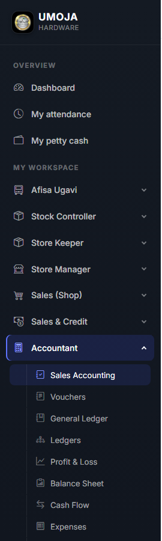

#### 8.1 Sales Accounting — taking the till into the books

Every sale made at the till — cash, credit, part-paid — lands here as **Pending**, however it was settled.
*Nothing is revenue until you post it.*

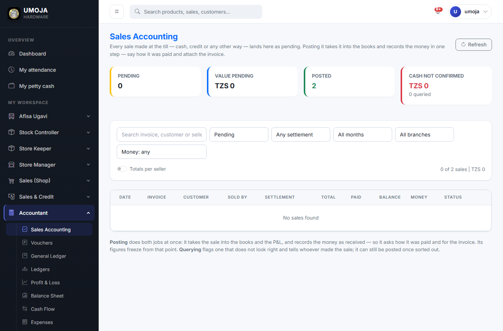

1. **Filter** to *Pending* (the default) and work down the list. The cards show how many are waiting and their value.
2. **Post & record payment** — one act does two jobs: it takes the sale into the books (and so into the P&L)
   **and** records the money as received. The form asks **how it was paid** (cash / bank / mobile / cheque / other)
   and for the **invoice to be attached**; only the amount you confirm counts as cash. A posted row **freezes** —
   its cost of sales and commission are fixed, so a later price change cannot move a profit already reported.
3. **Query** — if a sale does not look right (wrong customer, odd price, no invoice), press Query and type why.
   The seller is notified and the row shows *Queried*. It can still be posted once sorted out.
4. A sale **cancelled or deleted after posting** does not vanish — it stays, flagged for reversal, so the books
   never lose a number they once reported.

> **The till's "paid" is a claim, not a receipt.** Sales Accounting is where money is *confirmed*. The Cash Flow
> statement and the Balance Sheet read your confirmations, not the till.

#### 8.2 Vouchers — the double-entry books

Everything that is *not* a till sale enters the books as a **voucher**: a document whose debits equal its credits.
There are six kinds, and each kind only allows certain ledgers on each side — the dropdowns enforce it:

| Voucher | Debit side offers | Credit side offers | Use it for |
|---|---|---|---|
| **Sales** (SV-) | the customer, or a bank account / cash book | income ledgers and Output VAT | an invoice we raised — credit sale, cash sale, or part-paid |
| **Purchase** (PU-) | purchases / stock / expense ledgers and Input VAT | the supplier, or a bank account / cash book | an invoice a supplier gave us |
| **Receipt** (RV-) | bank accounts and cash books | every ledger *except* bank/cash | money coming in |
| **Payment** (PV-) | every ledger *except* bank/cash | bank accounts and cash books | money going out |
| **Contra** (CV-) | bank accounts and cash books | bank accounts and cash books | moving our own money (bank ↔ cash, bank ↔ bank) |
| **Journal** (JV-) | any ledger | any ledger | adjustments, accruals, corrections |

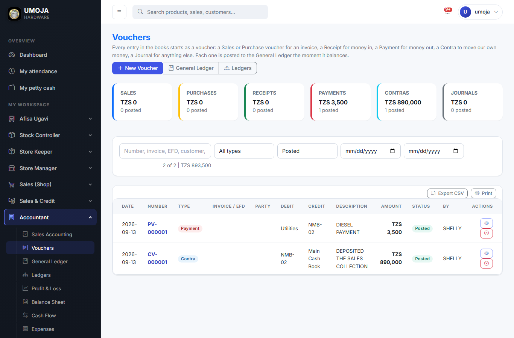

**Entering a voucher** — *Accountant → Vouchers → New Voucher → (type)*:

1. **Date of Transaction** is required. Description is free text.
2. Pick the **debit** ledger and type the **amount**. The moment the two sides differ, **the difference is written
   into the next empty amount field on the short side** — you only pick its account. Type over it if you want a
   different split; another line opens for what is left. Keep going until **Difference = 0**.
3. Add as many debit and credit lines as you need (**+ Line**). Remove one with ✕.
4. The bar at the bottom always shows **Total Debit, Total Credit and the Difference**. **Post Voucher stays
   disabled until they balance** — and the server checks again, so an unbalanced voucher can never be posted.
5. On posting, the voucher gets its **number** (RV-000012 and so on, one sequence per type) and **one General
   Ledger entry per line** is written at once.

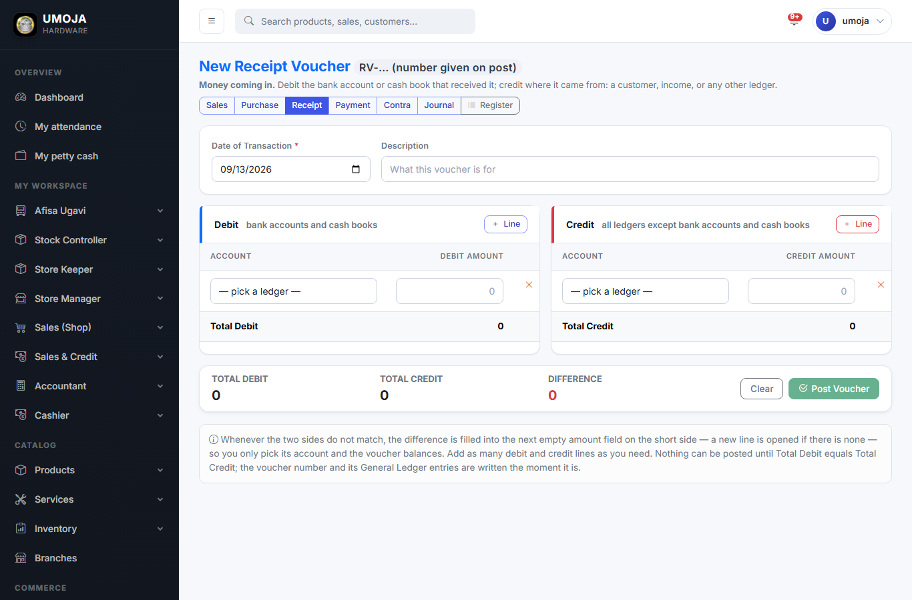

**Allocating to invoices.** When you **credit a customer on a Receipt** (they paid us) or **debit a supplier on a
Payment** (we paid them), their **outstanding invoices or bills** appear under the line: number, date, original
amount, what is already paid or allocated, and what is **outstanding**. Type the amount against each one — or
press **oldest first** — and the invoice's balance falls the moment the voucher posts. You can never allocate more
than is owed, and never more than the line carries.

**Sales and Purchase vouchers** carry more, because they *are* the invoice:

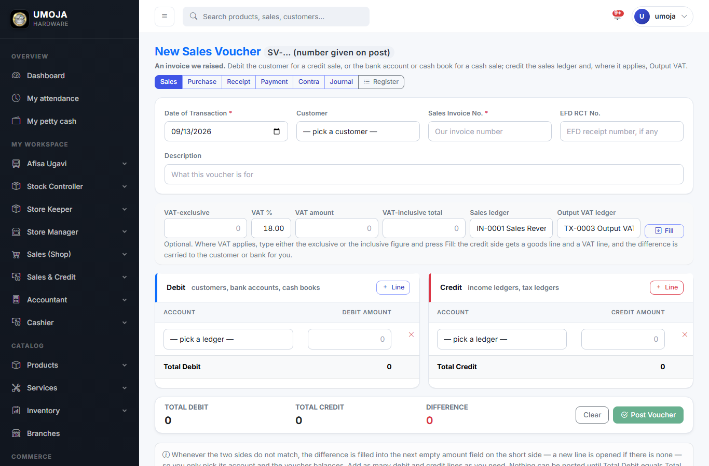

- **Customer / Supplier** — pick the party. Their ledger lands on the party side for you (a credit sale). For a
  **cash sale** just pick the bank account or cash book on that line instead. A **deposit** is both: a bank line
  for what was paid, the customer line for the rest.
- **Sales Invoice No.** (or the supplier's **Purchase Invoice No.**) is **required and unique**; the **EFD RCT No.**
  is a *separate* field, also unique (per supplier on purchases). Both are searchable in the register, and the
  invoice number rides on every General Ledger row of the voucher.
- **VAT box** — type the **VAT-exclusive** or the **VAT-inclusive** figure (the rate comes from Settings), press
  **Fill**, and the goods line and the VAT line are written for you; the difference lands on the party side.
- **Payment status** — *Cash, Bank, Credit* or *Partly Paid* — is **read off your lines**, never typed, and shown
  live in the totals bar.
- What a Sales voucher leaves on the customer is an open invoice like any till sale: a later **Receipt** is
  allocated against it (and a Purchase voucher against a **Payment**).

> **Sales and Purchase vouchers do not create a till sale or a purchase order.** They are the *books'* record of
> an invoice — for back-dated work, for months before the system, for anything the till never saw.

**Wrong voucher?** Vouchers are never edited. Open it and press **Cancel** (with a reason): its entries leave the
General Ledger, the document stays on record marked *Cancelled*, and any invoice it had settled is owed again.

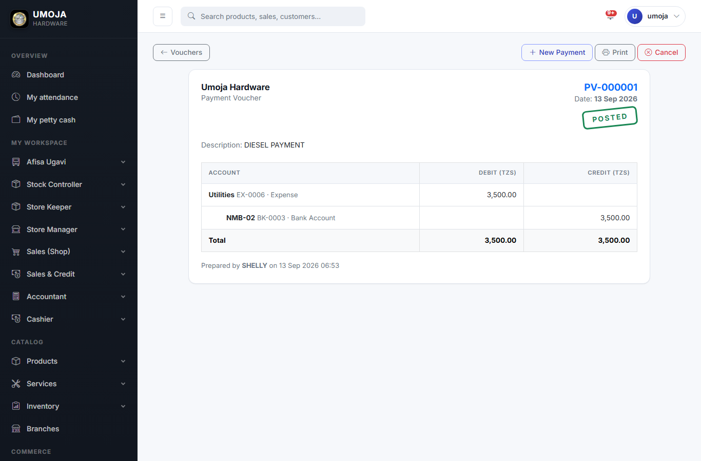

#### 8.3 Bulk Import — a spreadsheet of vouchers

Back-dated work arrives as a spreadsheet, not one voucher at a time. **Vouchers → Bulk Import**:

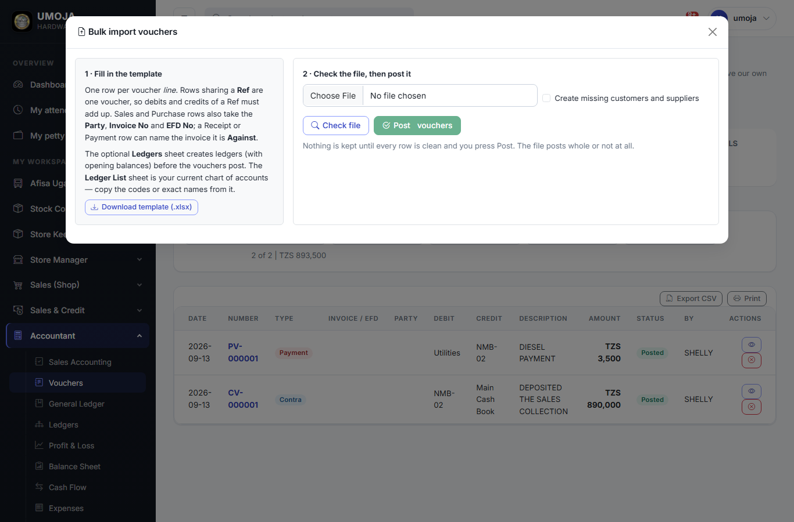

1. **Download the template.** It has four sheets: **Vouchers** (where you type), **Ledgers** (optional), **Ledger
   List** (your current chart of accounts — copy codes or exact names from it) and **How to fill**.
2. On **Vouchers**, one row per voucher **line**. Rows sharing a **Ref** (any text — `1`, `2`, or the invoice number)
   are one voucher, so the debits and credits of a Ref must add up. Columns: Ref, Type, Date, Ledger, Side (Dr/Cr),
   Amount, Description, **Party**, **Invoice No**, **EFD No**, **Against**, Narration.
   - On a Sales/Purchase row, write **`Customer`** or **`Supplier`** in the Ledger column to mean *the Party's own
     ledger*.
   - On a Receipt row crediting a customer (or a Payment row debiting a supplier), **Against** names the invoice or
     bill it settles — a till invoice number, `PO-12`, or a Sales/Purchase voucher's invoice number.
3. On **Ledgers** (optional), ledgers to **create first**, with **opening balances** and their side — a new bank
   account, Capital, Motor Vehicles. Customers and suppliers are *not* created here; name them on a voucher row and
   tick **Create missing customers and suppliers** if they are new.
4. **Check file.** Every voucher is run through the same checks as the form; the report lists each one — rows,
   type, party, invoice, totals — with **ready** or the exact error (*row 8: no ledger called "Nowhere Bank"*).
   Nothing is kept.
5. When every row reads *ready*, **Post N vouchers**. **The file lands whole or not at all** — one bad row and
   nothing posts, so a half-imported month cannot happen. Voucher numbers run in date order.

#### 8.4 General Ledger and Ledgers

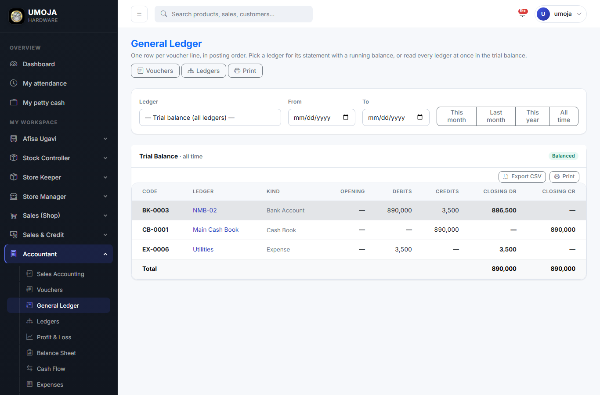

- **General Ledger** — pick a ledger for its **statement** with opening balance, every entry (date, voucher,
  type, invoice, description, debit, credit) and a running balance; or leave it on **Trial balance** for every
  ledger at once, with opening, movements and closing Dr/Cr. The two closing columns always agree — that is what
  double entry buys. Date range and This month / Last month / This year / All time are at the top.
- **Ledgers** (the chart of accounts) — every ledger has a **kind** (bank, cash book, customer, supplier, income,
  expense, asset, liability, tax, equity) and that kind is what puts it in the right dropdowns. **Bank accounts,
  customers and suppliers get their ledger automatically** the moment they exist elsewhere in the system — never
  create those by hand. Add your own income/expense/asset ledgers here, set **opening balances** (with the side),
  and **close** a ledger you no longer use rather than deleting it (a ledger with entries cannot be deleted).

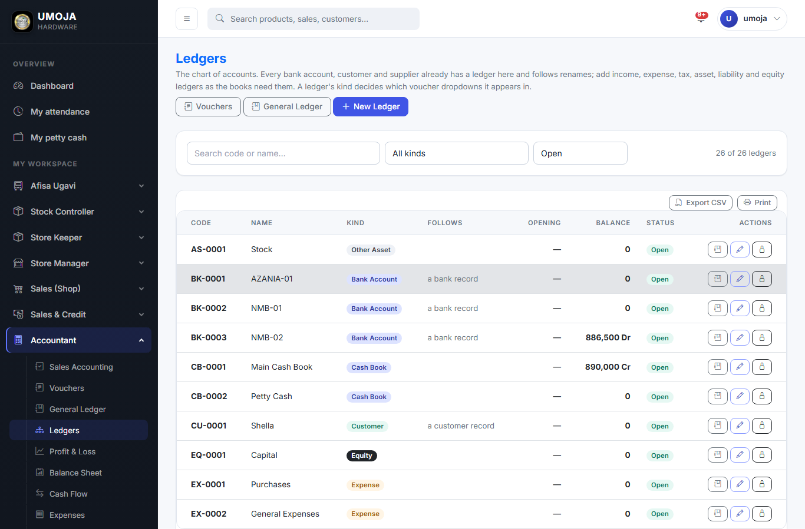

#### 8.5 The three statements

| Statement | What it reads | Notes |
|---|---|---|
| **Profit & Loss** | Revenue from **posted** sales only, less cost of sales, commission, expenses, petty cash payouts and other payments; plus other income; less tax payments | Cash confirmed is shown *beside* revenue, never instead of it |
| **Cash Flow** | Receipts dated by **when you confirmed them**, supplier payments, petty cash payouts, other payments, taxes | Supplier payments made **from credit** are excluded — no money moved. Petty cash top-ups are an internal transfer, shown as a note |
| **Balance Sheet** | **Today only.** Stock, debtors (invoices Accounts has not confirmed), cash (derived from the cumulative cash flow), creditors (every live purchase order) | The system holds no capital, drawings or fixed-asset records, so the gap between net assets and retained earnings is shown as **unrecorded** — that is honest, not a bug |

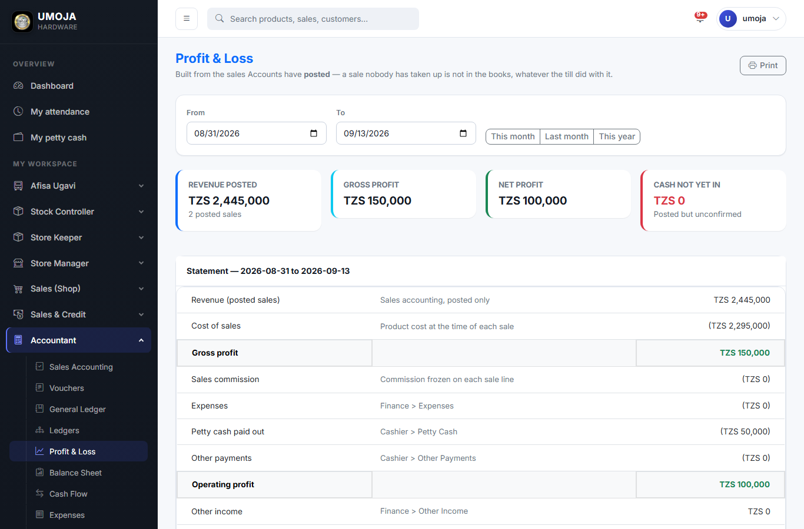
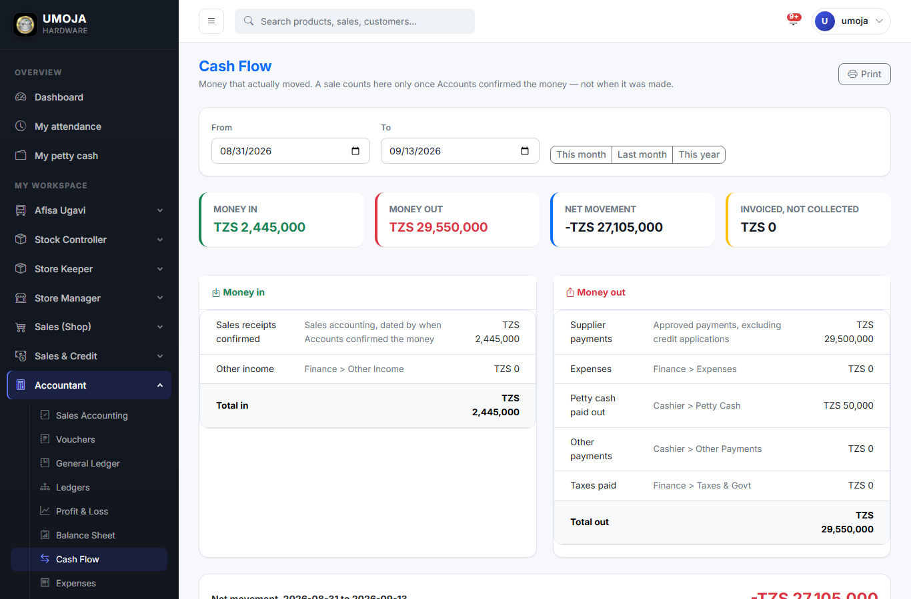
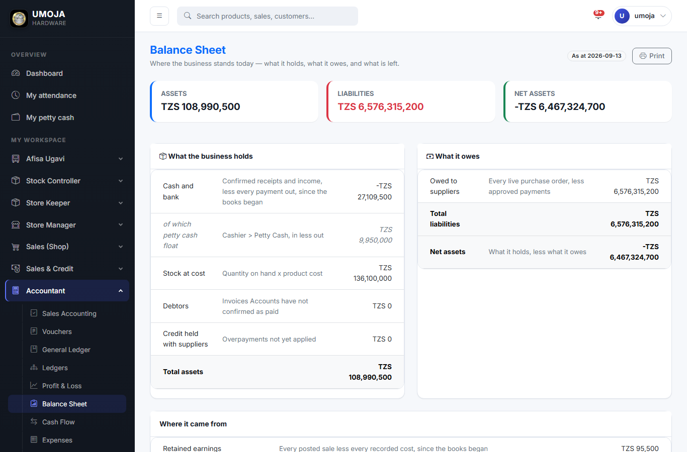

#### 8.6 CRM — the customer register

*CRM → Customer Records* is a standalone register of who bought what and what they still owe. **Every till sale
syncs into it automatically** with its paid / part-paid / credit state, and a payment recorded on the sales side
updates the same row. You can also **bulk-import** rows from Excel/CSV (download the template on the page),
**export** the register, and print a **PDF statement** for one customer or for the whole list. Fields people
maintain — **TIN**, **EFD receipt number**, receipt number — are yours to fill and are never overwritten by the
sync. Editing a CRM row never changes a sale.

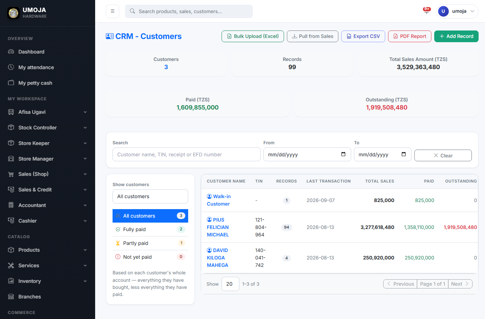

#### 8.7 Expenses, income, taxes, debtors

1. **Expenses** — *Finance → Expenses → Add expense*. Pick a category, the amount, which bank account it was paid
   from, and **attach the receipt photo**.
   
2. **Other income** — *Finance → Income*, for income that is **not** a product sale (rent, services).
3. **Tax payments** — *Finance → Taxes*: type (VAT, PAYE, SDL, …), period, amount, and the **TRA receipt number**.
   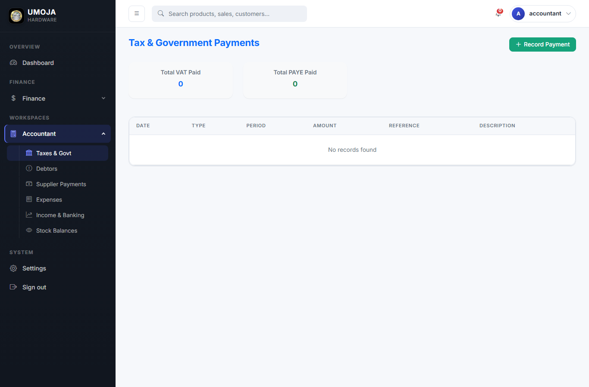
4. **Debtors** — *Debtors* lists only sales that are **still short**, showing the **outstanding** amount. **View**
   opens the invoice; **Record Payment** enters money as it arrives.
   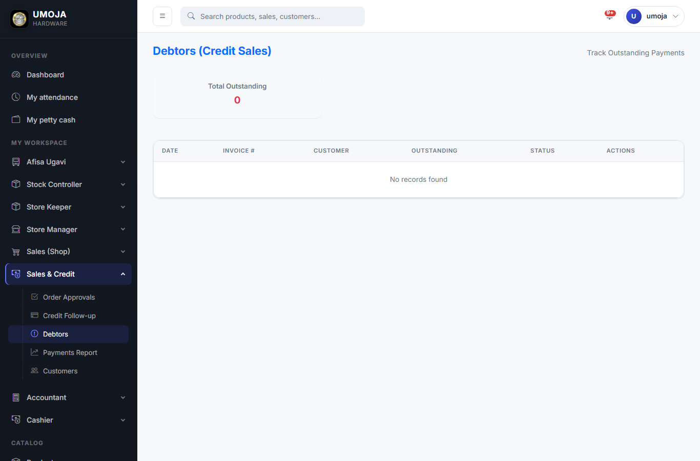
5. **Bank accounts** — *Finance → Banks*: the accounts expenses and payments are paid from. Each one also has a
   ledger in the books, kept in step automatically.
6. **Reports** — aging, profitability by category, commission per rep.

**Tips**
- **Post the till daily.** Until a sale is posted it is not revenue, its money is not cash, and the statements do
  not know it exists.
- The **difference bar is your friend**: when the credit side is short, the next credit line opens with the gap
  already typed in. Pick the account and you are balanced.
- **Never total supplier payments without filtering to approved** — a recorded payment is a *request* until the
  Admin approves it. The screens already do this for you.
- **One route per fact.** A supplier's bill is either a purchase order (raised by Afisa Ugavi, paid by the
  Cashier) *or* a Purchase voucher (typed by you for back-dated work) — not both.
- The **two documents** that define this module — *Voucher Data Entry Requirements* and *Application Requirements
  for Back-dated Work* — are implemented as written, with one correction: their example puts a 200,000 difference
  on a new *Debit* line; the rule (and the system) put it on the **short** side.

**Try it now:** post a Receipt of 1,000,000 into the bank, crediting a customer 800,000 (allocate it to one of
their invoices) and Sales Revenue for the 200,000 the system carries to the second line. Then open the General
Ledger, pick the bank, and find the entry.

---

### 9. Cashier

**Who you are:** the person who holds the cash tin. Money leaves the business through your hands — but only
after somebody else has said yes.

**What you can do:** keep the **petty cash float** (top it up, record what goes out); **hand over** petty cash the
Admin has approved; **record** supplier payments against purchase orders and **resubmit** ones the Admin sent
back; record **other payments** that are neither a supplier invoice nor a tax; read the **By Supplier** account
view. You cannot approve anything — every payment you record is a *request* until an Administrator approves it.

Your menu is **Cashier** in the sidebar.

**Your daily flow**

1. **Petty Cash** — *Cashier → Petty Cash*. The cards show the **float balance**, cash in and cash out. **Top Up
   Float** records money put into the tin; **Record Payment** records a voucher going out (payee, category,
   branch, what for). Rows are grouped by month; the whole register exports to CSV.
   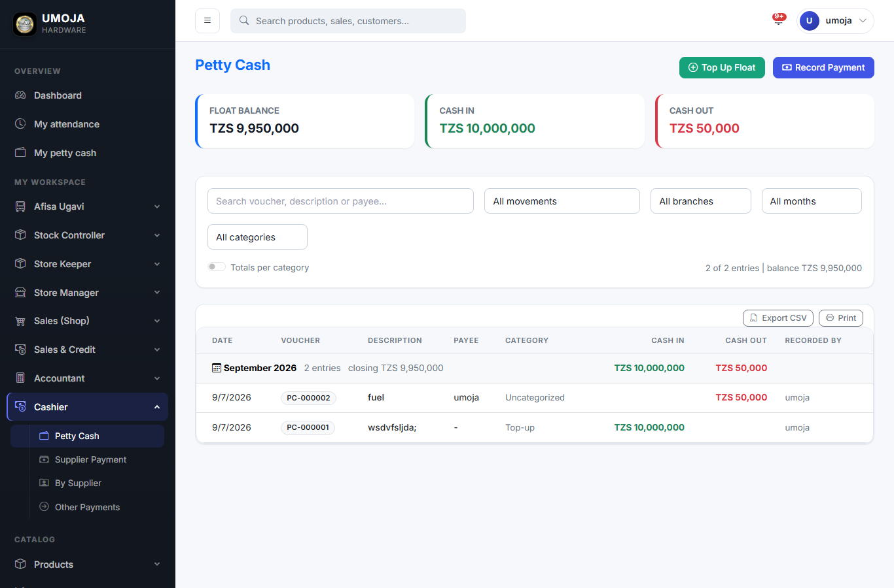
2. **Hand over approved requests** — the **To Issue** section on the same page lists petty cash requests an
   Admin has approved. Press **Done** *only when the money is in the person's hand*. That is the moment the float
   moves; a request that is approved but not issued has not touched the tin. If issuing would take the float
   negative the system refuses — **top the float up first**.
3. **Supplier Payments** — *Cashier → Supplier Payment*. Pick the **order** being paid (the list is every order
   with a supplier that still has a balance, drafts included); the supplier comes from the order, never typed.
   Enter amount, method, reference, date, a note. It is saved **Pending** and goes to the Admin.
   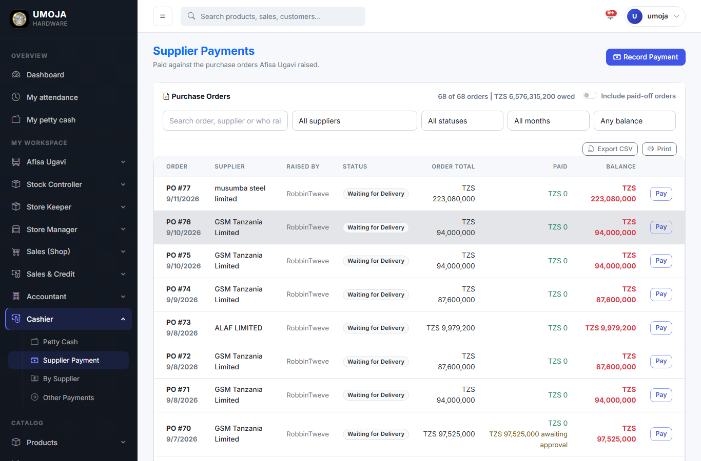
   - **Approved** → the balance on the order falls and the money shows in the Cash Flow.
   - **Rejected** → it comes back to you with the Admin's **decision note**. Open it, **amend** the entry (only
     pending and rejected rows can be edited), add your reply and **Resubmit** — it goes back as Pending. Both notes
     stay on the record for the whole loop.
   - **Supplier credit** — if you ever *over*-pay an order (10m paid on a 10m order plus another 10m), the supplier
     holds that money for us. The figure shows on the order form; spend it by recording a payment **from credit**
     against another of their orders. It draws the credit down and moves no cash.
4. **By Supplier** — *Cashier → By Supplier*: for each supplier, what was **ordered**, what is **paid** (approved
   only), what is **pending** approval and what is **still owed**. Narrow the paid side to a month.
   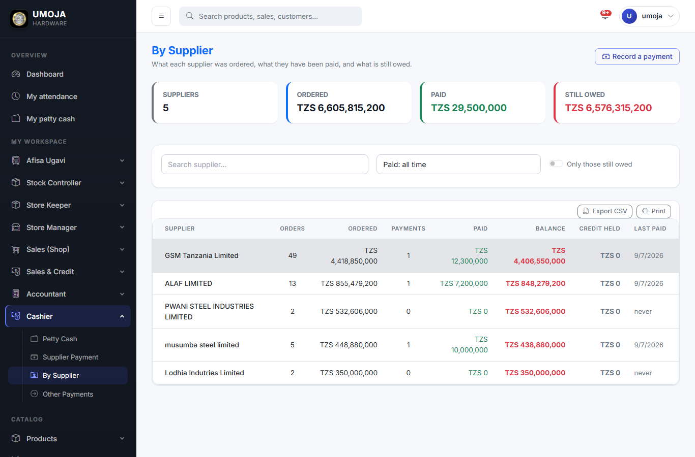
5. **Other Payments** — *Cashier → Other Payments*: payouts that are neither a supplier invoice nor a tax (a refund,
   a casual labourer, a licence). Payee, category, method, amount, receipt reference.
   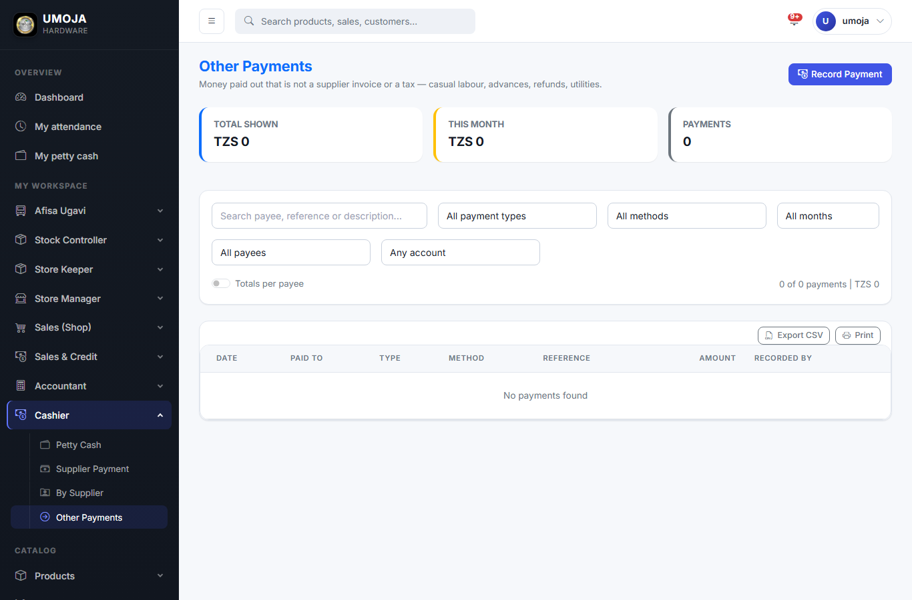

**Tips**
- **Pending money is not paid money.** Every total on your screens counts approved payments only; the pending
  figure is shown separately so you can chase it.
- Petty cash **requests** are raised by the people who need the money (*My petty cash*), approved by the Admin,
  and issued by you. Three people, three moments — never short-cut it by recording a payment straight from the tin
  for something that was meant to be requested.
- Export a month's petty cash to CSV before the count; it is what the filters show, nothing more.

**Try it now:** top the float up by 100,000, raise a petty cash request as another user, have the Admin approve
it, press Done on it, and watch the float fall.

---

### 10. HR Officer

**Who you are:** the HR administrator who keeps employee records up to date.

**What you can do:** create, view, **edit and delete** employee records; view departments and job positions; manage leave requests; record attendance; upload employee documents; view performance reviews.

> *Payroll, departments setup, performance authoring and disciplinary actions are the **HR Manager's** job (next chapter).*

**Your daily flow**
1. Open **HR → HR Dashboard** for an overview of headcount and pending items.
2. **Employees** — *HR → Employees*. Search and filter by status, department, or branch.
3. **Add an employee** — *HR → Add Employee*. Fill in identification (Employee #, names, NIDA/TIN/NSSF/NHIF), contact, employment (department, position, branch, hire date), compensation, and bank details. Save.
4. **Delete an employee** — on the employee list, use the **trash** button.
   - The system **refuses to delete** an employee who already has payslips and shows a clear message. In that case set their **status to *Terminated*** instead of deleting, so payroll history is preserved.
5. **Leave requests** — *HR → Leave Requests*. Record requests; an approver (HR Manager/Admin) approves or rejects.
6. **Attendance** — *HR → Attendance*. Record or correct daily attendance for staff.
7. **Documents** — upload contracts, IDs, certificates against each employee.

**Tips**
- Prefer **Terminated** over delete for anyone who has ever been paid — it keeps a clean audit trail.
- Fill in **NIDA / TIN / NSSF / NHIF** at onboarding; payroll relies on them later.
- An employee can only **clock themselves in/out** (My attendance) if their login is **linked to their employee record** — your administrator sets that link.

**Try it now:** create a test employee, then try to delete one who has a payslip and read the message.

---

### 11. HR Manager

**Who you are:** the head of HR — everything the HR Officer does, **plus** the org chart, payroll, performance and discipline.

**What you can do (in addition to HR Officer):** create/edit departments, job positions and leave types; **run payroll**; manage payslips; author performance reviews; record disciplinary actions; approve/reject leave.

**Your daily flow**
1. **Set up the org chart** (once, then maintain) — *HR → Departments* and job positions. Assign a department head.
2. **Leave types & approvals** — define leave types (annual, sick, etc.); approve or reject leave requests. Approving a leave that starts today flips the employee to **On leave**.
3. **Run payroll** (monthly):
   1. *HR → Payroll* → create a **Payroll Period** for the month/year (it starts as **Draft**).
   2. Open the period → **Generate payslips**. The system creates one payslip per **active** employee and auto-computes Tanzanian statutory amounts: **PAYE** (TRA brackets), **NSSF 10%** (employee + matching employer), **WCF 0.5%**, **SDL 4%**, plus NHIF and other deductions you enter. The period becomes **Processed**.
   3. Review/adjust individual payslips if needed (e.g. overtime, bonus, advances) — totals recalculate automatically.
   4. **Mark paid** once salaries are disbursed → the period becomes **Paid**.
4. **Performance reviews** — *HR → Performance*. Record period, rating (1–5), strengths, areas to improve, goals.
5. **Discipline** — *HR → Discipline*. Record warnings, suspensions, terminations with reason and date.

**Tips**
- **Generate payslips is idempotent** — re-running it on a period recomputes existing payslips rather than duplicating them. Safe to re-run after fixing salaries.
- Deleting a **payroll period** removes all its payslips (admin-restricted, with a warning) — only do this on a draft you created in error.
- PAYE is computed on **gross minus NSSF**, matching TRA's taxable-income definition. Brackets follow FY 2024/2025; update them if the government changes them.

**Try it now:** create a payroll period for the current month, generate payslips, open one and read the PAYE/NSSF breakdown, then mark the period paid.

---

### 12. Staff (general employee)

**Who you are:** an employee with a login but no specialist module access.

**What you can do:** self-service only — **My attendance** (clock in/out), **My petty cash** (raise a request and follow it), and **Profile** (update your name/email, change password). Everything else is hidden by design.

---

## Part C — The big flows (how roles connect)

These cross several roles. In training, run each flow live with a different trainee at each station.

### C1. Purchase → Delivery check → Stock (stock comes IN)

Goods do **not** become stock the moment the lorry arrives. Up to three people sign off first,
and a short delivery cannot be waved through.

```
Afisa Ugavi              Store Manager                Admin
───────────              ─────────────                ─────
Raise Purchase Order
        │
Goods arrive — confirm ──►  Open THAT order alone,
                            check each item one by one
                                    │
             ┌──────────────────────┴───────────────┐
             │                                      │
      everything arrived                     something is short
             │                                      │
             ▼                                      ▼
      STOCK INCREASES                        Explain why it is short
      Order = Received                              │
                                                    ▼
                                          Admin confirms or rejects
                                                    │
                             ┌──────────────────────┴────────────┐
                        CONFIRM                              REJECT
                             │                                   │
             stock += only what arrived            nothing enters stock;
             balance stays owing on the order      back for a better reason
                             │
                    Order = Partially Received
                             │
              the rest arrives → Afisa Ugavi confirms again → round 2
```

| # | Role | Action | Result |
|---|---|---|---|
| 1 | Afisa Ugavi | Raise the PO (supplier, items, quantities, price) | PO open. *Stock NOT moved.* |
| 2 | Afisa Ugavi | Goods turn up → **Confirm** | PO goes to the Store Manager |
| 3 | Store Manager | *Deliveries to Verify* → open **one** PO → mark each item **All arrived** or **Short** | Every item must be counted before it can be submitted |
| 4a | — | Everything arrived | **Stock increases.** Order = Received. Admin not involved. |
| 4b | Store Manager | Something is short | Order flagged. ***Nothing enters stock yet.*** |
| 5 | Afisa Ugavi | Write the explanation (supplier short-shipped, damaged, etc.) | Goes to the Admin |
| 6 | Admin | *Delivery Approvals* → **Confirm** or **Reject** | Confirm: stock += what arrived, balance stays owing. Reject: back to step 5, nothing banked. |
| 7 | Afisa Ugavi | When the balance is delivered, **Confirm Balance** | Round 2 — the Store Manager checks only what is still owed |

**The rules everyone must remember:**
- The **PO itself never changes stock.**
- On a short delivery, **nothing at all enters stock — not even the items that came in full** — until the Admin confirms it.
- A part-delivered order stays open as **Partially Received**, showing exactly what is still owed. It is never closed early and never re-received twice.
- Each round keeps its own record: what was counted, who explained the shortfall, what the Admin decided.

> **Note on GRNs.** The Stock Controller's **Goods Received Note** screens still exist and a GRN
> also raises stock. Use **one** route per delivery — either the Store Manager's delivery check
> **or** a GRN — never both for the same goods, or the quantity is counted twice.

### C2. Sale → Dispatch → Delivery (stock goes OUT)

This is the most important flow. Here is one real walk-in sale moving through every station:

| # | Role | Action | Result |
|---|---|---|---|
| 1 | Sales Rep | Open POS, add products, pick customer, take payment, **Submit** | Sale = **Pending**. *Stock NOT moved.* |
| 2 | Sales Rep | Sale appears in Sales list as **Pending** | Rep is free to serve the next customer |
| 3 | Store Manager | *Order management* shows the order with Approve/Decline | Manager verifies customer & price |
| 4 | Store Manager | **Approve** | Order cleared for dispatch. *Stock STILL not moved.* |
| 5 | Store Manager | *Dispatch board* → assign Store Keeper + Vehicle | Order ready to ship |
| 6 | Store Manager | **Dispatch** | **Stock IS deducted now.** Status = **Dispatched**, vehicle = In transit, invoice + delivery note generated |
| 7 | Store Keeper | Pull goods, load the assigned truck | Goods leave the warehouse |
| 8 | Accountant | Record the fuel/freight **expense** behind the trip (receipt attached) | Cost captured against the month |
| 9 | Accountant | *Sales Accounting* → **Post & record payment** (method + invoice) | The sale is now revenue in the P&L and cash in the Cash Flow — see C5 |

**The two facts everyone must remember:**
- **Stock moves at Dispatch (step 6), not at Approve (step 4).**
- **Commission is frozen at sale creation (step 1)** based on the product's category. Changing the category rate later does **not** change historical sales.
- If a sale is later **deleted**, its stock is **restored** automatically.

Real captures of this flow:

| | |
|---|---|
| 1. Rep at POS  | 2. Sale pending  |
| 3. Manager sees pending  | 4. Manager approves  |
| 5. Dispatch board 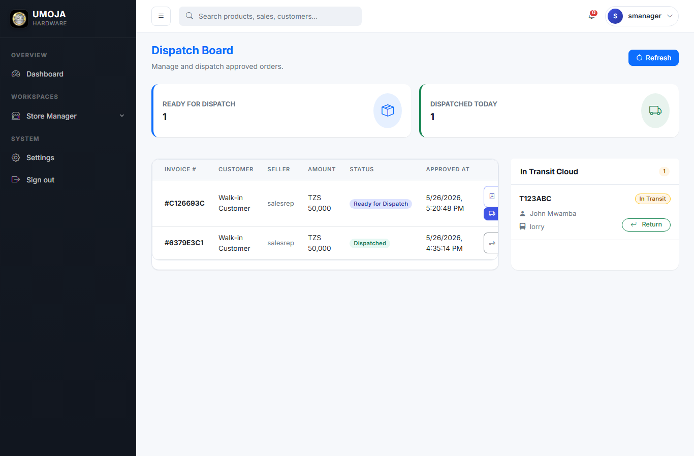 | 6. Dispatched (stock deducted) 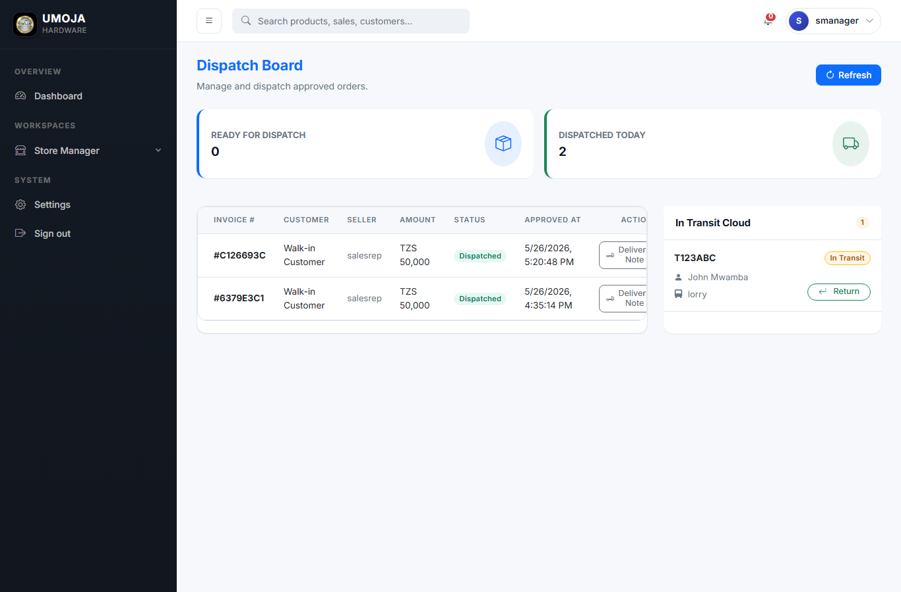 |
| 7. Sale now dispatched  | 8. Keeper picks  |
| 9. Accountant logs expense  | 10. Expense in list  |

### C3. The HR cycle

```
ONBOARD                LEAVE                  ATTENDANCE             PAYROLL (monthly)
───────                ─────                  ──────────             ─────────────────
HR Officer creates     Employee requests      Employee clocks        HR Manager creates period (Draft)
employee record   ───► leave  ───► HR Mgr ──► in/out (My         ───► Generate payslips (Processed)
(+ documents)          approves/rejects       attendance) or HR         → review/adjust
                                              records it                → Mark paid (Paid)
```

- Onboarding: HR Officer adds the employee and uploads documents.
- Leave: a request is raised, then HR Manager/Admin approves or rejects. An approved leave starting today sets the employee to **On leave**.
- Attendance: staff clock themselves in/out (if their login is linked to their employee record), or HR records it.
- Payroll: **Draft → Processed (generate) → Paid (mark paid)**. Statutory deductions are automatic.
- Leaving the company: prefer **Terminated** status over deletion if the person has payslips.

### C4. Money going out — the two approval loops

Nobody pays out of their own say-so. Both loops end at the **Admin**, and the money only counts once the Admin
has said yes.

**Supplier payment**

```
Cashier                          Admin                         Cashier
───────                          ─────                         ───────
Record payment on a PO  ──►  Approve ──► PAID: order balance falls, Cash Flow shows it
      (Pending)               │
                              └─ Reject (with a note) ──►  Amend the entry, reply, Resubmit ──► back to Admin
```

| # | Role | Action | Result |
|---|---|---|---|
| 1 | Cashier | *Supplier Payment* → pick the order → amount, method, reference → Save | Payment = **Pending**. *Nothing owed has changed.* |
| 2 | Admin | *Administration → Supplier Payment Approvals* → **Approve** | Payment = **Paid**. Order balance falls; Cash Flow records it |
| 2b | Admin | **Reject** with a decision note | Back to the Cashier as **Rejected** |
| 3 | Cashier | Open it → amend → reply → **Resubmit** | Pending again, both notes kept |


**Petty cash**

| # | Role | Action | Result |
|---|---|---|---|
| 1 | Anyone | *My petty cash* → New request (amount, purpose) | Request = **Pending** |
| 2 | Admin | *Administration → Petty Cash Approvals* → **Approve** / **Reject** | Approved requests appear on the Cashier's *To Issue* list |
| 3 | Cashier | *Petty Cash → To Issue* → **Done** when the money is handed over | **The float falls now.** Request = Issued |


**The rule everyone must remember:** an approved request is still a *promise*; the tin only changes when the
Cashier presses Done, so the float on the screen is always the cash actually in the box.

### C5. From the till to the books

```
Sales Rep            Store Manager            Accountant                    Statements
─────────            ─────────────            ──────────                    ──────────
POS sale  ──►  Approve ──► Dispatch  ──►  Sales Accounting: PENDING  ──►  Post & record payment
(any way paid)      (stock falls here)        (query it if wrong)        (method + invoice attached)
                                                                                 │
                                                             P&L revenue ◄───────┴───────► Cash Flow receipt
                                                             Balance Sheet: debtor cleared, cash up
```

- The till says a sale is *paid*; **Accounts confirms it**. Until then the sale is pending in the books, not
  revenue, and its money is not cash.
- Posting **freezes** the row (cost of sales and commission fixed). A sale cancelled later stays in the books
  flagged for reversal.
- Nothing Accounts does can stop the shop: a queried sale is still approved and dispatched on its own track.

### C6. Opening the books, or catching up months — back-dated work

```
Accountant
──────────
Download the Bulk Import template
   │
Ledgers sheet: new ledgers + opening balances (Capital, bank balances, vehicles…)
Vouchers sheet: every past Sales / Purchase / Receipt / Payment / Contra / Journal, one row per line
   │
Check file ──► fix the rows named in red ──► Check again ──► Post (whole file or nothing)
   │
General Ledger → Trial balance (balanced) → P&L / Cash Flow / Balance Sheet
```

- **Sales and Purchase vouchers** carry the party, the **invoice number** and the **EFD number**, so the historical
  invoices are searchable exactly like live ones.
- A past **Receipt** row with **Against** = the invoice number settles that invoice, so the customer's outstanding
  balance comes out right from day one.
- Because the file posts **whole or not at all**, you can iterate on the spreadsheet without ever leaving half a
  month in the ledger.

---

## Part D — Mobile app, troubleshooting, and exercises

### D1. Mobile companion app — *Umoja Pro* (Android)

Umoja Pro signs in with the **same username/password** as the website and shares the **same data**.


1. **Sign in** — open Umoja Pro, enter your credentials, tap **Sign in**. The app remembers your token so you stay signed in across launches. Sign out from the profile menu in the app bar.
2. **Four tabs at the bottom:**
   - **POS** — open a new sale, search products, take payment.
   - **Stock** — current stock per branch with low-stock alerts.
   - **Quotes** — list of quotations; tap to convert to a sale.
   - **Customers** — directory; add customers; view a customer's sales history.
3. **Same backend, live updates** — sales created on the phone appear in the Manager's Order Management on the website immediately; stock changes broadcast in real time so other devices update without refreshing.

**Mobile tips**
- If **Sign in** seems to do nothing, the build is probably pointing at the wrong API. Reinstall a build configured for `https://umoja.ehub.co.tz`.
- **Pull down to refresh** any tab.
- Sign out from the profile menu to clear the saved token.

### D2. Troubleshooting (give this to every trainee)

| Symptom | Likely cause | What to do |
|---|---|---|
| A menu item or button is missing | Your role lacks that permission | Ask the Administrator to check your role |
| Signed out unexpectedly | 20-minute inactivity timeout | Sign in again |
| A product won't show in POS search | Out of stock at your branch | Check inventory / receive stock |
| POS refuses the sale: "not enough stock" | The branch cannot fill it — stock already promised on other pending/approved sales counts | Reduce the quantity, sell from another branch, or wait for stock. Back-orders are not allowed |
| "Cannot delete employee… has payslips" | Payroll history is protected | Set status to **Terminated** instead |
| Customer wrongly shows as a debtor | A cash payment wasn't entered, or Accounts has not posted the sale | Record the payment on the sale; Accountant posts it in Sales Accounting |
| Vehicle stuck as "busy" | Not marked returned | Store Manager → Vehicles → **Return** |
| Live counts look stale | Lost real-time connection | Refresh the page (Ctrl+R) |
| Post Voucher stays disabled | Debits ≠ credits, a line has no account, or (Sales/Purchase) no invoice number | Read the **Difference** bar — the short side is named; fill the account on the highlighted line |
| "… cannot be credited on a RV receipt voucher" | The ledger is not allowed on that side for that type | Check the table in 8.2; a Journal accepts any ledger |
| "Invoice … is already in the books" | Duplicate invoice or EFD number on a Sales/Purchase voucher | Find the existing one (search the register by invoice or EFD) — or cancel it if it was wrong |
| Bulk import: "Not posted … with errors" | One or more rows failed — the file posts whole or nothing | Fix the red rows, **Check file** again, then Post |
| Petty cash **Done** refused | The float would go negative | **Top Up Float** first |
| Supplier payment total looks low | Pending payments are not counted | Ask the Admin to clear *Supplier Payment Approvals* |
| Statements ignore a sale | It is still **Pending** in Sales Accounting | Post it (with method and invoice) |

### D3. Trainer checklist — run these live, in this order

Set up one trainee (or one shared screen) per role and complete the loop end to end:

- [ ] **Admin:** create a branch, a category (with commission %), and one user per role below.
- [ ] **Procurement:** add a supplier; raise a PO for two products; **Confirm** when the goods "arrive".
- [ ] **Store Manager:** *Deliveries to Verify* — mark one item short; watch it go to Afisa Ugavi and the Admin.
- [ ] **Admin:** *Delivery Approvals* — confirm; confirm stock rose by only what arrived.
- [ ] **Sales Rep:** create a quotation; convert it to a sale; submit (status = Pending). Try to sell more than is in stock and read the refusal.
- [ ] **Store Manager:** approve the order; dispatch it (assign keeper + vehicle); confirm stock dropped.
- [ ] **Store Keeper:** find the dispatched order in the dispatch feed.
- [ ] **Cashier:** record a supplier payment on the PO; **Admin:** reject it with a note; **Cashier:** amend and resubmit; **Admin:** approve.
- [ ] **Anyone:** raise a petty cash request; **Admin:** approve; **Cashier:** press Done and watch the float fall.
- [ ] **Accountant:** in *Sales Accounting*, post the dispatched sale with method + invoice; see it in the P&L and Cash Flow.
- [ ] **Accountant:** post a Receipt voucher allocated to a customer invoice; open the General Ledger for the bank.
- [ ] **Accountant:** post a Sales voucher with VAT for a back-dated invoice; then a Receipt against it.
- [ ] **Accountant:** download the Bulk Import template, fill three vouchers, Check, break one on purpose, fix it, Post.
- [ ] **Accountant:** record an expense with a receipt; open the receipt from the list.
- [ ] **HR Officer:** create an employee; upload a document; try (and fail) to delete a paid employee.
- [ ] **HR Manager:** create a payroll period; generate payslips; open one; mark the period paid.
- [ ] **Everyone:** clock in via *My attendance*; update your profile password.
- [ ] **Mobile:** sign in to Umoja Pro; create a sale; watch it appear on the web Order Management.

---

### Quick reference

- **Web:** https://umoja.ehub.co.tz  ·  **Mobile:** Umoja Pro (Android)
- **Session timeout:** 20 minutes of inactivity
- **Stock rises:** at GRN / delivery check.  **Stock falls:** at Dispatch.  **No back-orders:** a sale the branch cannot fill is refused at the POS.
- **Commission:** auto, frozen at sale creation, by product category.
- **Three approval queues (Admin):** Delivery Approvals · Supplier Payment Approvals · Petty Cash Approvals.
- **Money counts when:** a supplier payment is *approved*; petty cash is *issued* (Done); a sale is *posted* in Sales Accounting.
- **Vouchers:** SV Sales · PU Purchase · RV Receipt · PV Payment · CV Contra · JV Journal — post only when Total Debit = Total Credit; the difference fills the next line on the short side.
- **Bulk import:** one row per line, grouped by Ref; whole file or nothing.
- **Payroll path:** Draft → Processed (Generate) → Paid (Mark paid).
- **Missing a button?** It's your role's permissions — ask the Administrator.

*A slide-deck version of the role chapters (with screenshots) is at `docs/Umoja_User_Guide.pptx`.*
